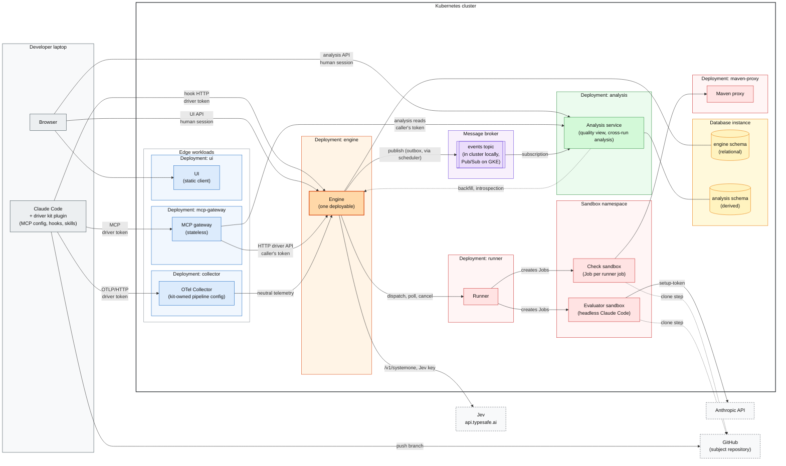
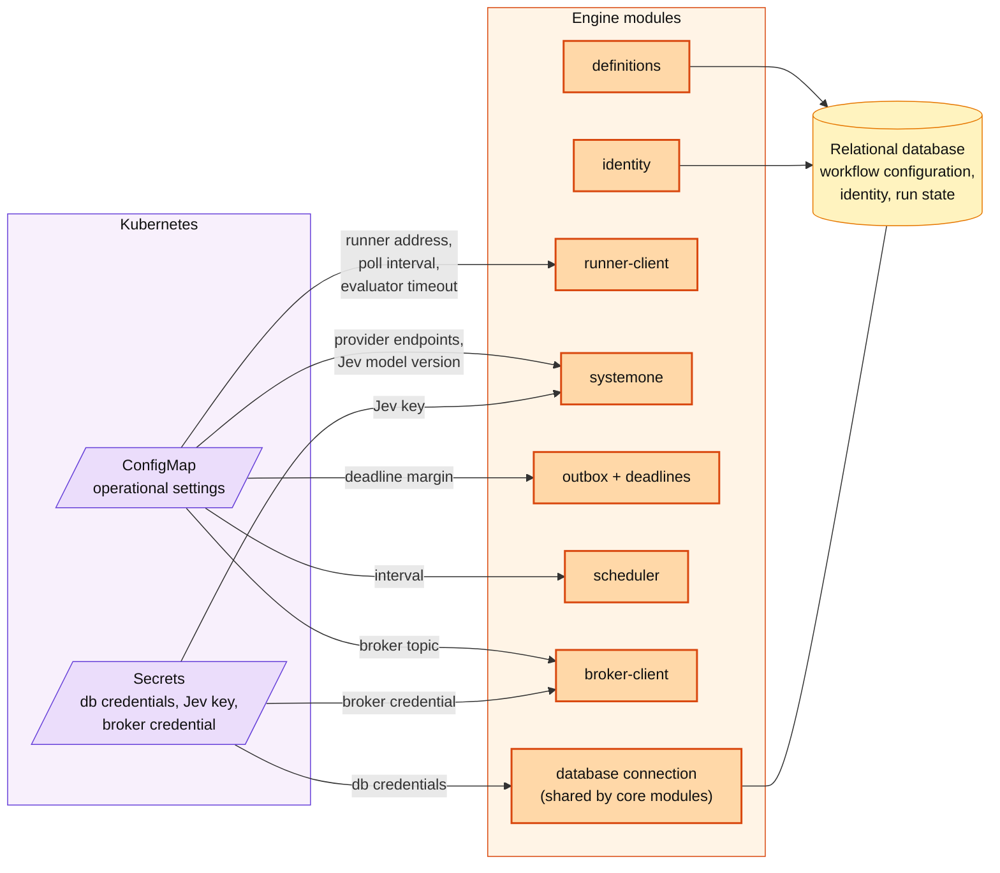
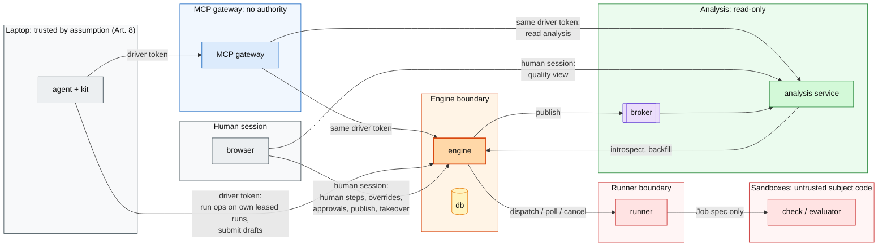

# Target architecture

From spike 010 (`specs/010-target-architecture/`), where every decision is recorded in the Log and its question (Q1–Q28). Terms are defined in `docs/concepts/glossary.md`. The happy path sequences are in `sequences.md`, and a short record of each key choice is in `decisions.md`.

The architecture is technology-neutral. Spike 9 picks the framework, the database product, UI technology, and build tools. The database is relational (Q22), and where a choice depends on the product, this document names a pattern, not a product.

**MVP** marks what the MVP builds. **Target** marks what the architecture leaves room for but the MVP does not build.

## Components

Colors, used the same way in every diagram here: gray for the laptop and callers, blue for edge workloads and inbound adapters, teal for inbound ports, orange for the engine and core modules, green for analysis, purple for the broker, outbound ports, and configuration sources, yellow for data, red for the runner, sandboxes, and outbound adapters, and dashed gray for external systems.

Each box inside the cluster is its own workload, deployed and scaled on its own. The engine schema and the analysis schema share one database instance in the MVP, with separate credentials (Q22, Q23). Namespaces, apart from the sandbox namespace, are settled in PLAN spike 10.

| Component | MVP role | Holds | Never |
| --- | --- | --- | --- |
| Engine | The single authority: definitions, identity, runs, state, events, checkpoints, scoring, leases, deadlines, runner dispatch, DecisionEngine calls, telemetry ingestion, event publication, the HTTP driver API, UI API, human login, credential introspection | Database credentials and the Jev key (Kubernetes Secrets); operational settings (ConfigMap) (Q21) | Pushes work to drivers (Art. 9); calls a model except through DecisionEngine adapters (Art. 4) |
| MCP gateway | Translates MCP tool calls into calls to the engine's public HTTP driver API, the same API the hooks call (Q20), and analysis read tools into calls to the analysis API (Q23) | Nothing: no state, no credential of its own; it forwards the caller's driver token unchanged | Decides anything, caches run state, or reaches the database; when the engine is down, it returns an error (fail closed) |
| Database (relational, Q22) | Engine schema: workflow configuration, identity (users, roles, human accounts, hashed driver tokens), state tables, the event table, idempotency records, the outbox, deadlines, telemetry rows, small evidence payloads. Analysis schema: analysis's derived store, with separate credentials (Q23) | | Engine schema reachable by anything but the engine |
| Analysis service | Consumes engine events and joined telemetry from the broker, builds its own projections, and serves the quality view and cross-run analysis (rates, agreement, weakest step, version comparison, typed decision tree paths and conclusions) through a read API (Q23, Q28) | Its own schema credentials and a broker subscription credential | Writes engine state, computes run scores (Art. 1), reads the engine's tables, or accepts approvals or drafts |
| Message broker | Durable, at-least-once delivery of engine events to analysis; topic keyed by run ID. Product chosen in PLAN spikes 9 and 10 (Pub/Sub on GKE; an emulator or self-hosted broker locally) | Messages for a limited retention | Being the record: the engine's events are the source for rebuilds |
| UI | One static or thin client of two APIs: the engine's UI API (inbox, human steps, escalations, runs, scores, definition approval) and the analysis API (quality view). Shows the change itself through the subject view the definition declares, read in the browser from the git host at the reviewed revision, with the human's own login (Q26) | Nothing authoritative | Holds a credential that can approve (Q4) |
| Runner | Turns a job packet into a sandbox, classifies the outcome, keeps the result until the engine fetches it. Reads all content from git at the revision: for checks, evaluators, and typed-decision input packets (Q26) | The repository read token, the `setup-token`, a service account limited to the sandbox namespace | Calls the engine or holds an engine credential (Q2) |
| Check sandbox | Runs a `command` step's image and argv at the revision, with service sidecars | Nothing beyond the job's literal `env` | Egress beyond the Maven proxy |
| Evaluator sandbox | Runs headless Claude Code with read-only tools on the rendered task | The `setup-token` (accepted risk, Q10) | Egress beyond Anthropic's API hosts; write tools |
| Jev | Hosted typed decisions over `/v1/systemone` (spec 007); the only DecisionEngine provider in the MVP (Q27) | | Seeing a subject other than `sample-crm` |
| OTel Collector | Receives OTLP/HTTP from the laptop, deletes and redacts attributes, maps Claude Code names to neutral names, forwards to the engine and a raw file (spec 006, Q9) | | A route from sandboxes |
| Driver kit | MCP config, hooks (one script), skills, instructions; maps tool calls to protected action names (Q3) | The driver token (`userConfig`, sensitive) | Workflow-specific steps (Art. 9) |

The laptop reaches three endpoints, all with the driver token: the MCP gateway, the engine's HTTP driver API (hooks), and the collector. The browser reaches the UI, the engine's UI API, and the analysis API with a human session.

**Not in the MVP:** `laya-serve`. Laya needs training to be useful, which is too costly now (Q27). It returns later as a second provider behind the DecisionEngine port.

**Target:** GKE Sandbox (gVisor) for sandbox pods on GKE (Q25), content-addressed evidence storage (INTENT Persistence), hash-chained events, an external identity provider, and a runner-side token proxy so the `setup-token` never enters a sandbox.

## Engine modules

One deployable (Q1). Two things are not part of it. The MCP gateway is its own Deployment and calls the `driver-api` adapter over HTTP like any other client (Q20). Analysis is its own service, fed through the broker (Q23). Neutrality is enforced by module dependency rules checked in the build (G7). Spike 9 picks the tool.

The engine is hexagonal on both sides (Q24):

- **Inbound adapters:** turn an outside trigger into a call on an inbound port. The triggers are an HTTP request, or a timer tick from the `scheduler`.
- **Inbound ports:** the use cases the core offers. Each call is one use case and one transaction.
- **Core:** implements the inbound ports (arrows from a port point to the modules that carry out its use cases), holds every rule and all state, and has no provider or domain-specific names (SDLC, git, Claude Code, the broker product); it may use Spring annotations (AD-20, refined by spike 012). It runs no threads.
- **Outbound ports:** interfaces the core defines for what it needs from outside.
- **Outbound adapters:** implement the outbound ports for a specific runner, provider, or broker.

```mermaid
flowchart LR
  subgraph callers["Callers"]
    direction TB
    hooks["Driver hooks"]
    gw["MCP gateway"]
    uiclient["UI (browser)"]
    coll["OTel Collector"]
    an["Analysis service"]
  end

  subgraph inadapters["Inbound adapters"]
    direction TB
    driverapi["<b>driver-api</b><br/>HTTP driver API"]
    uiapi["<b>ui-api</b><br/>HTTP UI API"]
    ingest["<b>telemetry-ingestion</b><br/>OTLP batches"]
    feed["<b>event-read</b><br/>HTTP for analysis"]
    sched["<b>scheduler</b><br/>timer tick"]
  end

  subgraph inports["Inbound ports"]
    direction TB
    pdriver["DriverOperations"]
    phuman["HumanOperations"]
    ptele["TelemetryIntake"]
    pfeed["EventFeed"]
    pdue["DueWork"]
  end

  subgraph core["Core (neutral)"]
    direction TB
    identity["<b>identity</b><br/>who is calling, what they may do"]
    defs["<b>definitions</b><br/>validate, version, publish"]
    runs["<b>runs</b><br/>runs, sessions, leases, evidence,<br/>events, idempotency, status"]
    cp["<b>checkpoints</b><br/>transition requests and attempts"]
    eval["<b>evaluation-tasks</b><br/>tasks for reasoning steps"]
    score["<b>scoring</b><br/>points, deductions, run score"]
    td["<b>typed-decisions</b><br/>walks decision trees"]
    outbox["<b>outbox + deadlines</b><br/>what to dispatch, publish, expire"]
  end

  subgraph outports["Outbound ports"]
    direction TB
    rport["RunnerPort"]
    dport["DecisionEngine"]
    eport["EventPublisherPort"]
  end

  subgraph outadapters["Outbound adapters"]
    direction TB
    rclient["<b>runner-client</b>"]
    systemone["<b>systemone</b><br/>Jev"]
    bclient["<b>broker-client</b>"]
  end

  subgraph external["External"]
    direction TB
    runner["Runner"]
    providers["Jev"]
    broker["Message broker"]
  end

  db[("Engine schema")]

  hooks --> driverapi
  gw --> driverapi
  uiclient --> uiapi
  coll --> ingest
  an --> feed

  driverapi --> pdriver
  uiapi --> phuman
  ingest --> ptele
  feed --> pfeed
  sched --> pdue

  pdriver --> runs
  pdriver --> cp
  phuman --> cp
  phuman --> defs
  ptele --> runs
  pfeed --> runs
  pdue --> outbox
  inports -- "authenticate" --> identity

  cp -- "pinned version" --> defs
  cp -- "step results, events" --> runs
  cp -- "reasoning steps" --> eval
  cp -- "on pass" --> score
  cp -- "outbox rows, deadlines" --> outbox
  cp -- "shadow trees" --> td
  td -- "tree from pinned version" --> defs
  td -- "one question per call" --> dport
  td -- "input packet job" --> outbox
  outbox --> rport
  outbox --> eport

  rport -. "implemented by" .-> rclient
  dport -. "implemented by" .-> systemone
  eport -. "implemented by" .-> bclient
  rclient --> runner
  systemone --> providers
  bclient --> broker

  core -- "one transaction per use case" --> db

  classDef laptop fill:#ECEFF1,stroke:#37474F,color:#111
  classDef edge fill:#DCEBFC,stroke:#1565C0,color:#111
  classDef inport fill:#C5F6FA,stroke:#0B7285,color:#111
  classDef engine fill:#FFD8A8,stroke:#D9480F,color:#111,stroke-width:2px
  classDef analysis fill:#D3F9D8,stroke:#2B8A3E,color:#111
  classDef broker fill:#EBDDFB,stroke:#6741D9,color:#111
  classDef data fill:#FFF3BF,stroke:#E67700,color:#111
  classDef runner fill:#FFE3E3,stroke:#C92A2A,color:#111
  classDef external fill:#F8F9FA,stroke:#495057,color:#111,stroke-dasharray:4 3
  class hooks,gw,uiclient,coll laptop
  class an analysis
  class driverapi,uiapi,ingest,feed,sched edge
  class pdriver,phuman,ptele,pfeed,pdue inport
  class identity,defs,runs,cp,eval,score,td,outbox engine
  class rport,dport,eport broker
  class rclient,systemone,bclient runner
  class runner,providers,broker external
  class db data
  style callers fill:#FFFFFF,stroke:#868E96,color:#111
  style inadapters fill:#F1F7FE,stroke:#1565C0,color:#111
  style inports fill:#EDFCFE,stroke:#0B7285,color:#111
  style core fill:#FFF4E6,stroke:#D9480F,color:#111
  style outports fill:#F8F0FC,stroke:#6741D9,color:#111
  style outadapters fill:#FFF5F5,stroke:#C92A2A,color:#111
  style external fill:#F8F9FA,stroke:#495057,color:#111,stroke-dasharray:4 3
```

Spike 013 refines the core's arrows (`docs/engine/design.md` section 1): a `usecases` package implements the inbound ports, and it alone calls RunnerPort, DecisionEngine, and EventPublisherPort, with no lock held. `outbox + deadlines` and `typed-decisions` only record what is due. This removes the `outbox` → `checkpoints` cycle.

### Inbound ports

Each call is one use case and one transaction. The use case authenticates through `identity`, takes the idempotency key, locks the run row, does the work, writes events and outbox rows, and commits (Q5, Q16). `DueWork` is the exception: it runs one short transaction per due item and phase, and calls the runner, Jev, and the broker with no lock held (spec 013 Q1; `docs/engine/design.md` section 6).

| Inbound port | Use cases | Called by |
| --- | --- | --- |
| `DriverOperations` | Register and bind a session, `start_run`, `status`, `submit_evidence`, `request_transition`, `checkpoint_status`, `get_evaluation_task`, `submit_step_result`, `record_activity`, `authorize_action`, `submit_draft`. Schemas and the MVP subset are in `docs/driver-api/` (spike 011): `checkpoint_status` folds into `status`, and `report_iteration`, `get_definition`, and `get_analysis` are added | `driver-api`; later a CLI |
| `HumanOperations` | Log in, decide a human step, override, resolve an escalation (Q8), approve and publish a definition, take over a lease (Q14), view runs and scores | `ui-api` |
| `TelemetryIntake` | Accept a neutral telemetry batch, check the driver token, join records to runs by session ID within binding windows, and drop unbound sessions (spec 006) | `telemetry-ingestion` |
| `EventFeed` | Paged, ordered read of events and joined telemetry for rebuilds, and credential introspection (Q23) | `event-read` |
| `DueWork` | Drain due outbox rows (dispatch runner jobs, publish events), poll running runner jobs and apply their results, and fire due deadlines, which record *not evaluated* (Q2, Q6, Q23) | `scheduler` |

### What each module does

| Module | Layer | Responsibilities | Called by | Calls | Owns (engine schema) |
| --- | --- | --- | --- | --- | --- |
| `driver-api` | Inbound adapter | HTTP for the driver contract (Q20). Maps requests and idempotency keys onto `DriverOperations`, and turns rule failures into actionable denials | Driver hooks; MCP gateway (with the caller's token) | `DriverOperations` | Nothing |
| `ui-api` | Inbound adapter | HTTP for the UI, including the human login form and session cookie (Q4). Maps onto `HumanOperations` | UI in the browser | `HumanOperations` | Nothing |
| `telemetry-ingestion` | Inbound adapter | Receives OTLP batches from the collector and hands them to `TelemetryIntake` | OTel Collector | `TelemetryIntake` | Nothing |
| `event-read` | Inbound adapter | HTTP for analysis backfill and introspection | Analysis service | `EventFeed` | Nothing |
| `scheduler` | Inbound adapter | A timer that calls `DueWork` every few seconds. The only thread that starts engine work on its own, always for work the engine dispatched itself (Art. 9) | Its own timer | `DueWork` | Nothing |
| `identity` | Core | Users, workspaces, roles, and human accounts. Authenticates driver tokens (stored hashed) and human sessions, issues sessions, and answers scope checks and introspection. Driver scopes never include approvals (Art. 2) | Every inbound port's use cases | Nothing | Users, roles, workspaces, human accounts, driver token hashes, sessions |
| `definitions` | Core | Validates a definition's YAML against the schema and its 19 semantic rules, stores drafts, and publishes immutable versions that the engine numbers. Owns the decision tree definitions as part of each version: their typed questions, branches, conditions, conclusions, and limits (rules 12, 17, 18; Q28). Supersedes the previous version, and resolves the version a run pins (spike 003, Q22) | `DriverOperations` (drafts), `HumanOperations` (approve, publish), `checkpoints`, `typed-decisions` | Nothing | Definition versions (YAML as approved plus parsed document), including their decision trees |
| `runs` | Core | Runs and subject keys (one active run per workflow and subject), sessions and bindings, leases (Q14), stage visits and iterations, escalations, evidence (driver-reported), and the append-only events. Also: idempotency records (Q16), the per-run row lock, `status` assembly, protected action authorization (stage in `allowed_in`, revision equals the reviewed revision, lease held; Q3), and the replay check (Q5) | Inbound port use cases, `checkpoints` | `definitions` | Runs, sessions, leases, stage visits, evidence, events, idempotency records, telemetry rows |
| `typed-decisions` | Core | Walks the decision tree a step declares, reading it from the run's pinned definition version in `definitions` (Q28). It owns the walk and its records, not the tree definition. Asks for one runner input packet for the whole tree (Q26), then asks the root question through the DecisionEngine port. It records the answer, checks the branches in order, and asks the follow-up or records the conclusion, until no branch matches or an answer is *not evaluated*. Each question has its own deadline. Shadow only: nothing it concludes changes the run | `checkpoints`, `DueWork` (packet results, deadlines) | `definitions`, DecisionEngine, `outbox + deadlines`, `runs` (events) | Typed decision records (every node, answer, branch, conclusion); provider call records, one row per call attempt with columns named after OTel `gen_ai.*` plus run, attempt, step, question, label, distribution, confidence, and truncation (spike 008); and the input packet, stored once per tree and referenced by each call |
| `checkpoints` | Core | Opens one attempt per transition request and runs its steps strictly in order, failing fast. Steps: built-in checks over evidence (`evidence_exists`, `field_compare`, `min_items`), runner `command` checks, reasoning steps (council median), and human steps (queued for the UI). Hands shadow typed decisions to `typed-decisions` in parallel and never waits for them (Q17). Records *passed*, *failed*, and *not evaluated* separately (Art. 7), and commits the transition when the attempt passes | `DriverOperations`, `HumanOperations` (human decisions), `DueWork` (results and deadlines) | `definitions`, `runs`, `evaluation-tasks`, `scoring`, `outbox + deadlines`, `typed-decisions` | Attempts, step results |
| `evaluation-tasks` | Core | Builds an evaluation task from a step's instructions, rendered rubric, and inputs. Hands it to the runner (through the outbox) or, later, to a driver. Tracks the task lifecycle (`issued → submitted / failed_to_run / cancelled`) and rejects late results | `checkpoints`, `DriverOperations` (driver-side evaluation, later) | `outbox + deadlines` | Evaluation tasks |
| `scoring` | Core | Computes step points, deductions per failed attempt, and the normalized 0–100 run score (spike 003). The only place a score is computed (Art. 1). Analysis aggregates scores but never computes them | `checkpoints`, the replay check | Nothing | Scores and their breakdown |
| `outbox + deadlines` | Core | The rules for outbox rows and deadlines. It writes them in the caller's transaction, and decides what is due when `DueWork` asks: runner dispatch named after the job ID (Q16), events and joined telemetry to publish (Q23), runner jobs to poll (Q2), and expired deadlines for runner jobs and shadow decisions (Q6). It starts nothing itself and calls nothing: the core's `usecases` package claims due items, calls RunnerPort, DecisionEngine, or EventPublisherPort with no lock held, and hands results to `checkpoints` or `typed-decisions` (spec 013) | `checkpoints`, `evaluation-tasks`, `typed-decisions`, `DueWork` | Nothing | Outbox rows, deadlines, runner jobs |
| RunnerPort | Outbound port | Dispatch, get, and cancel a runner job by job ID | `outbox + deadlines` | Implemented by `runner-client` | |
| DecisionEngine | Outbound port | Ask one typed question of one provider and get its answers, confidences, usage, and a truncation flag (Art. 4, spec 007). Trees are walked above it, never inside it (Q28) | `typed-decisions` | Implemented by `systemone` | |
| EventPublisherPort | Outbound port | Publish a batch of events with an ordering key (the run ID) | `outbox + deadlines` | Implemented by `broker-client` | |
| `runner-client` | Outbound adapter | HTTP client for the runner's three operations, and maps its results to step outcomes (Q13) | RunnerPort | Runner | |
| `systemone` | Outbound adapter | Calls Jev over `/v1/systemone` (Laya is not in the MVP, Q27) with the pinned model version, never an alias. Retries 429, 503, 529, other 5xx, timeouts, and connection errors up to 2 times with backoff, honouring `retry-after`, within 30 s, and never retries 400, 401, 403, 413, or 422. A call without an answer, or a truncated input, is *not evaluated*. Returns the resolved model, tokens, duration, error type, and `x-typesafe-request-id`, and sends no identifiers of ours. Refuses a subject that is not on the provider's allow-list, failing closed (spike 007, spike 008) | DecisionEngine | `api.typesafe.ai` | |
| `broker-client` | Outbound adapter | Publishes to the events topic: Pub/Sub on GKE, an emulator or self-hosted broker locally (Q23) | EventPublisherPort | Message broker | |

Dependency rules:

- Inbound adapters depend only on inbound ports. They never reach core modules directly (Q24).
- Core modules implement the inbound ports and depend only on each other and on outbound ports. They never depend on adapters.
- Outbound adapters depend only on the outbound port they implement.
- No SDLC, git, or Claude Code names in the core or its ports. Those live in definitions, driver kits, the collector config, and runner adapters.
- The broker product appears only in `broker-client`.
- Provider names (`jev` in the MVP) appear in definitions by design (schema rule 12) and in the `systemone` adapter's configuration, not in core code.
- A new transport, such as a CLI or MCP in process, is one more inbound adapter on the same ports.
- **Target:** a non-SDLC toy workflow test in CI (BACKLOG "Next").

## Configuration

Configuration is split by kind (Q21). INTENT Persistence puts all configuration in engine persistence. The MVP departs from that for operational settings and secrets.

| Kind | Examples | Held in | Owned by |
| --- | --- | --- | --- |
| Workflow configuration | Definitions and their versions, checkpoints, rubrics, scoring and deductions, typed questions and modes, driver capability requirements | Database. Drafts are editable, published versions are immutable, and runs pin a version | `definitions` |
| Identity and access | Workspaces, users, roles, the human accounts the engine logs in (Q4), driver tokens (stored hashed) | Database | `identity`, used by `driver-api` and `ui-api` to authenticate and authorize |
| Operational settings | Runner address, evaluator default timeout (Q6), deadline margin, scheduler interval, runner poll interval, provider endpoints, Jev model version (pinned, never an alias), Jev list price and its date, the allow-list of subject keys per external provider (only `sample-crm` for Jev), broker topic (spike 008) | Deployment config (a Kubernetes ConfigMap), read at startup | The module that uses each one: `runner-client`, `systemone`, `outbox + deadlines`, `scheduler`, `broker-client` |
| Secrets | Database credentials, the Jev key, the broker publish credential | Kubernetes Secrets, never the database | The modules that use them |

Rules:

- Operational values that affect an outcome are recorded on the result or event they affected: the evaluator default timeout, the deadline margin, and the provider model version. A replay then gives the same state and score after a setting changes.
- Anything that decides whether a step passes or how it scores belongs in the definition (pinned by version), not in operational settings.
- Provider names and endpoints are settings of the `systemone` adapter, so they stay out of core configuration.
- The analysis service has its own ConfigMap and Secrets (its schema credentials, broker subscription, engine address).
- Changing an operational setting means redeploying the engine. **Target:** operational settings stored in the database and edited in the UI (BACKLOG "Next").

## Runner interface

The engine calls the runner, and the runner never calls the engine (Q2). Three operations:

| Operation | Meaning |
| --- | --- |
| Dispatch job (job ID, packet) | Idempotent by job ID: the runner names the Kubernetes Job after it, so a second dispatch is harmless (Q16) |
| Get job (job ID) | Returns `pending`, `running`, or a final result. The engine polls it |
| Cancel job (job ID) | Deletes the Job. A cancelled attempt cancels its jobs, and late results are rejected (model.md) |

Packet, `command` job: image by digest, `run` argv, literal `env`, `services` with `ready` commands, `timeout`, subject repository, and revision (`docs/definitions/schema.md`, Steps).

Packet, evaluator job: evaluation task ID, step, rendered rubric and instructions, the subject inputs to read from its own clone (and evidence references, for workflows that use evidence), subject repository, base, and revision (INTENT, Fresh-context evaluation; Q26). Bounded by a runner-wide default timeout, since `agent_evaluator` has no `timeout` key (Q6).

Packet, input packet job: the subject inputs a typed question reads (for example the diff from the base and a file at a path), subject repository, base, and revision. The runner clones, resolves them, and returns them as bounded text. No model runs. The engine sends the text to the provider and stores it with the typed decision record (Q26).

Result: outcome (`passed`, `failed`, or `not_evaluated`), classification reason, provenance (runner, image, command, revision), evaluator usage (`modelUsage`), the evaluator's `structured_output`, a log tail of about the last 64 KB (Q18), and, for an input packet job, the resolved text. In the MVP, runner checks produce no evidence (spec 003 Q23); an input packet is input for a typed decision only, never evidence a step gates on.

Classification (Q13). The runner reads pod and container state, not only the Job condition, because a Job-level `DeadlineExceeded` cannot tell "never started" from "ran too long".

| Cause | Outcome |
| --- | --- |
| Exit 0 | passed |
| Non-zero exit; past `timeout`; OOMKilled during the main command | failed (reason shown) |
| Runner unavailable; revision not fetchable or clone failed; image pull failure; unschedulable; sandbox never started; service never ready; `DisruptionTarget` (eviction, preemption) | not evaluated |
| Evaluator: `is_error: true` or no `structured_output` | not evaluated |
| Engine deadline (job timeout plus a margin) passes without a result | not evaluated, and the job is cancelled (Q6) |

A council step is *not evaluated* if any member's job is *not evaluated* (Q12).

Sandboxes are Kubernetes Jobs, the same on the local cluster and on GKE (Q25). On GKE, the target is GKE Sandbox: pods use the gVisor RuntimeClass, every container (sidecars included) has CPU and memory limits, and a NetworkPolicy blocks the metadata server. Google Cloud Tasks is not a sandbox: it only delivers HTTP requests and runs no code. It cannot replace the outbox either, because enqueueing cannot join the database transaction. On GKE it could later be an optional delivery leg after the outbox, behind `RunnerPort`. Cloud Run functions are rejected as sandboxes: they are built from source rather than running a declared image, and they reuse instances across requests, so they are not throwaway. Cloud Run Jobs could become a second runner adapter later, behind the same runner interface.

The source adapter clones with a fine-grained, read-only repository token in a step before any subject code runs, for example an init container, so the token is not readable once the subject's code runs (Q11).

## How work moves forward

The engine is reactive (Art. 9). A run's state changes only on:

1. a driver request (through the MCP gateway or a hook, both on the HTTP driver API),
2. a human decision from a UI session,
3. a runner result the engine polled, or an engine deadline passing, for work the engine dispatched itself.

Nothing pushes work. The driver and the UI learn about every change by pulling `status`, `checkpoint_status`, or UI pages. The engine publishes events to the broker for analysis (Q23); that is a read-side feed, not work pushed to anyone.

At a human gate, the driver session ends. A later session resumes from the status injected at SessionStart (spec 005 G9, Q7). There are no notifications outside the UI in the MVP (Q19).

An attempt cannot hang. Every runner job has an engine deadline, and every shadow typed decision has its own deadline. An exhaustion escalation waits for the owner in the UI, and the owner's choice (extend, rework, abandon) is an engine-side change. For rework, the engine commits the rework transition itself (Q8).

## Persistence

- **Content stays in git (Q26).** The engine stores revisions, not code or diffs. The exceptions are runner log tails and the input packets sent to Jev, which are stored with the records they explain.
- **Database model:** one relational database with ACID transactions across tables, row-level locks, and unique constraints (Q22). Document-shaped data goes in document columns (for example PostgreSQL `jsonb`).
  - A definition version is one row holding its YAML exactly as approved, plus a parsed document.
  - Event payloads and evidence payloads are documents.
  - Runs, stage visits, attempts, step results, decisions, leases, idempotency records, the outbox, deadlines, identity, and telemetry are ordinary tables.
  - Analysis has its own schema in the same instance (MVP), with separate credentials. Its projections are relational, so cross-run analysis is joins and aggregates (Q23).

  The product is chosen in PLAN spike 9.
- **Source of truth:** state tables. Every state change writes its events in the same transaction (Art. 7, Q5).
- **Events:** append-only, with actor, actor type, timestamp, run, definition version, correlation ID, session, evidence references, and reason (INTENT, Transition protocol). They must carry everything replay needs, including the revision on each transition request and every lease holder.
- **Replay** is a check, not the read path. It rebuilds runs, attempts, step results, decisions, leases, and scores from the events alone and compares them with the tables (milestone 2). Telemetry is joined to runs but is not run state, and it is not replayed.
- **Serialization:** each request on a run locks the run's row for its transaction (Q16).
- **Idempotency:** every mutating driver call and every human UI decision carries a key, stored with its result. The same key with a different payload is rejected, and a retry returns the stored result (IETF Idempotency-Key draft-07 semantics).
- **Outbox:** written in the same transaction as the state change, and drained at least once by the `scheduler` calling `DueWork` (Q24). It carries two kinds of work:
  - runner dispatch, made safe by the runner's job-ID naming (Q16);
  - events and joined telemetry rows to publish to the broker, made safe by analysis deduplicating by event ID (Q23).
- **Analysis store:** derived and rebuildable. It is fed live by the broker and rebuilt from the engine's paged event read, since broker retention is limited. Analysis stores its progress in the same transaction as each projection update.
- **Configuration** in the database (definitions, identity) is not run state. Runs pin a definition version, and outcome-affecting operational values are recorded on results (Q21).
- **Deadlines** are rows in the engine's own tables, found by `DueWork` when the `scheduler` ticks (Q24). There is no external scheduler, and the broker is used only for events to analysis.
- **Leases:** binding a session acquires the run's lease for its user. Another user's binding is refused unless the owner takes over in the UI. No heartbeat in the MVP (Q14).
- **Target:** hash-chained events, content-addressed evidence storage, lease heartbeat and takeover by timeout.

## Trust boundaries and auth

| Credential | Held by | Allows |
| --- | --- | --- |
| Driver token (one per user, static) | Driver kit `userConfig`; passed through, never stored, by the MCP gateway | MCP (via the gateway), hook HTTP, and OTLP for the user's own runs where the user holds the lease; reading cross-run analysis from the analysis service, which checks it by introspection; submitting draft definitions to the engine (Q15, Q23). Never approvals, overrides, human step decisions, publishing, or lease takeover |
| Human session | Browser, issued by the engine's login (Q4); accepted by analysis after introspection (Q23) | Reading the quality view; human steps, overrides, escalation resolutions, definition approval and publishing, lease takeover. Separation of duties applies |
| Database credentials, engine schema | Engine, from a Kubernetes Secret | Everything in the engine schema |
| Database credentials, analysis schema | Analysis service, from a Kubernetes Secret | Its own schema only (Q23) |
| Broker publish credential | Engine | Publishing to the events topic |
| Broker subscription credential | Analysis service | Consuming the events subscription |
| Jev key | Engine, from a Kubernetes Secret | Calls to `api.typesafe.ai` for `sample-crm` only |
| Repository read token (fine-grained) | Runner, used in the clone step | Reading the subject repository (Q11) |
| `setup-token` | Runner, passed to evaluator sandboxes | Headless Claude Code on the owner's subscription (Q10) |
| Runner service account | Runner | Creating and deleting Jobs and pods in the sandbox namespace only |

Accepted MVP risks:

- The laptop is trusted (Art. 8). Merge protection is hook-based, and GitHub branch protection is the real gate.
- One person holds both UI accounts (owner and approver), so separation of duties is exercised but not enforced between real people.
- Evaluator sandboxes hold the `setup-token` while reading agent-written code. This is mitigated by read-only tools, spec 005's isolation flags, and egress to Anthropic's API hosts only (Q10).

## Open items for later spikes

- PLAN spike 8 (driver API contract): the analysis read API, the engine's introspection endpoint, and its paged event read (Q23); the HTTP driver API as the one contract, which the MCP gateway's tool schemas mirror (Q20); operation schemas, the `authorize_action` input as a neutral action name plus revision (Q3), idempotency key placement, denial format, and the evaluation task packet.
- PLAN spike 9 (technology stack): the framework, the relational database product (and its row-lock, outbox, and document-column implementation), the module rule checker, the runner's Kubernetes client, and the MCP gateway's SDK and version (Java SDK 2.1.0 stateful or 2.2.0 stateless, or another language) (Q20).
- PLAN spikes 9 and 10: the broker product (Pub/Sub on GKE; the emulator or a self-hosted broker such as NATS JetStream or RabbitMQ locally), with the Pub/Sub details recorded under Q23 checked against current docs.
- PLAN spike 10 (local setup): the namespaces, network policies for both sandbox kinds, secrets, and the collector config with the neutral name mapping.
- Spike 008 (Jev telemetry, closed): its decisions are taken in above. Provider calls are recorded in the engine's own table, with no OTel export. The engine keeps the correlation itself and stores `x-typesafe-request-id`. Costs are list-price estimates, and a deployment-config allow-list limits Jev to `sample-crm`. Its Laya parts wait until Laya returns (Q27).
