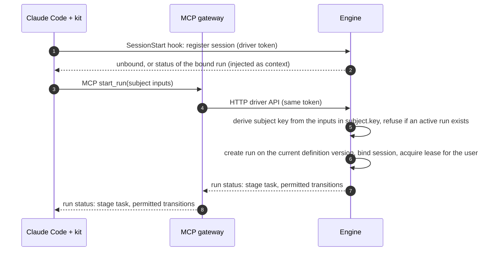
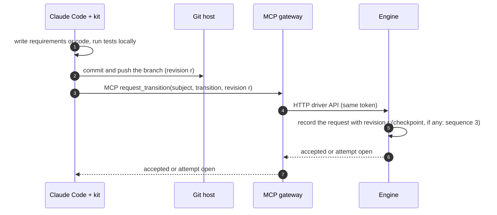
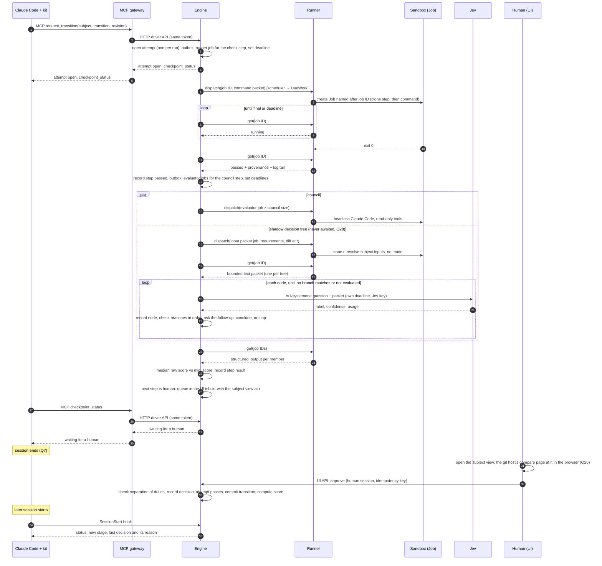
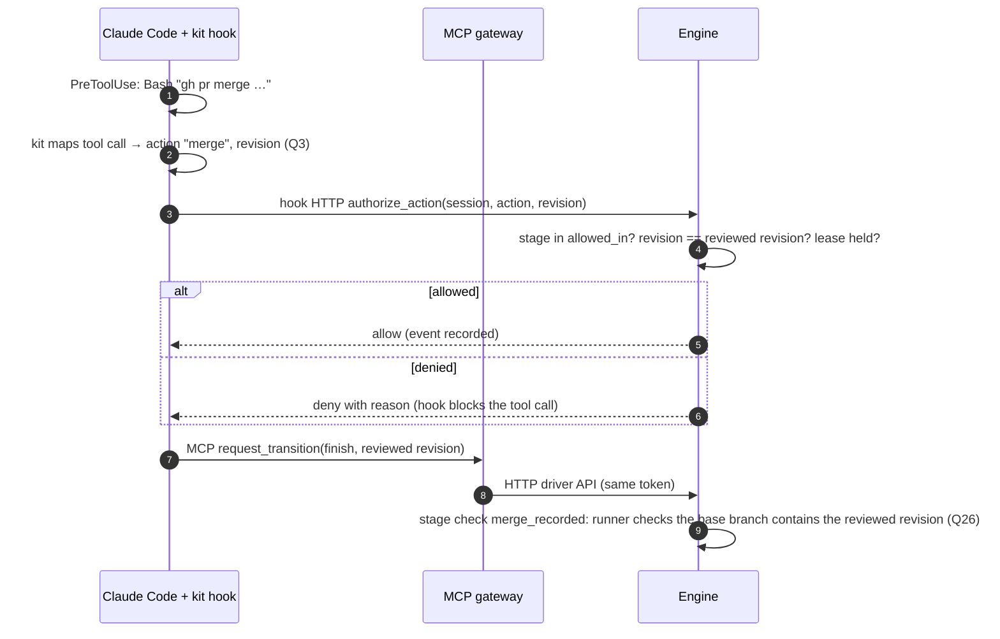
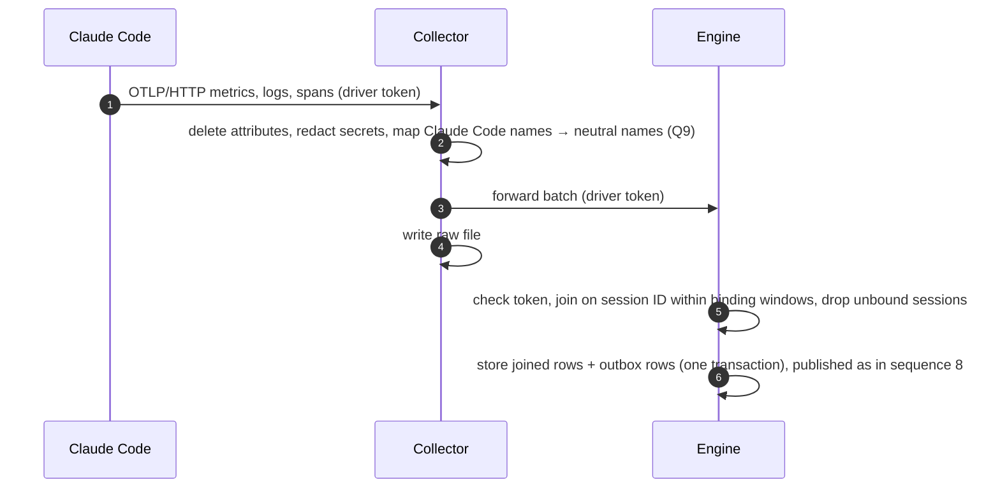
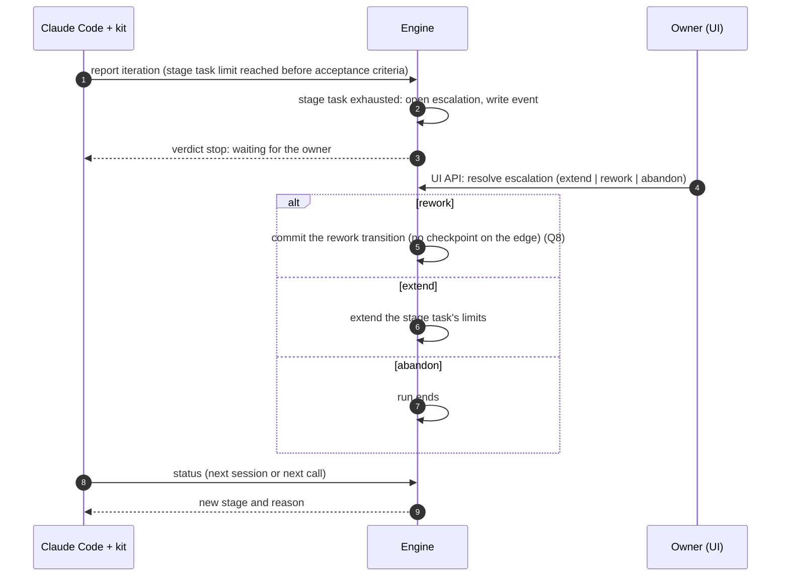
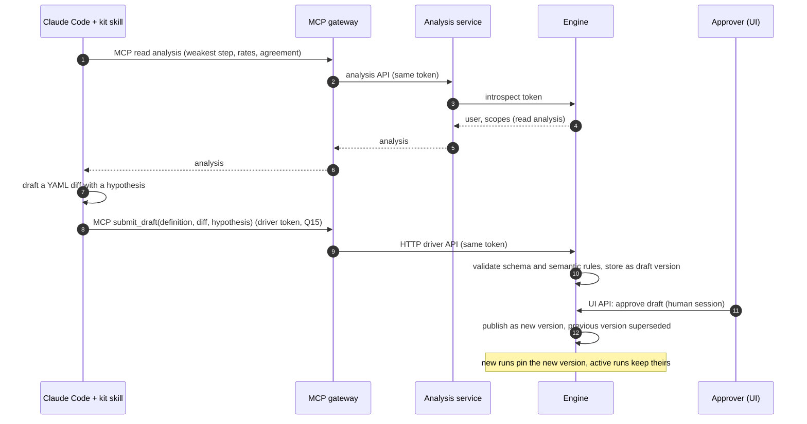
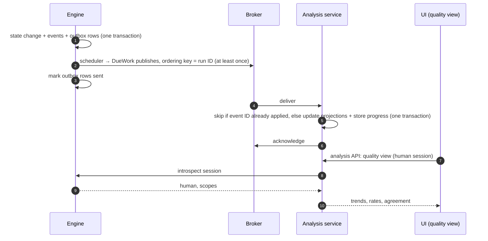
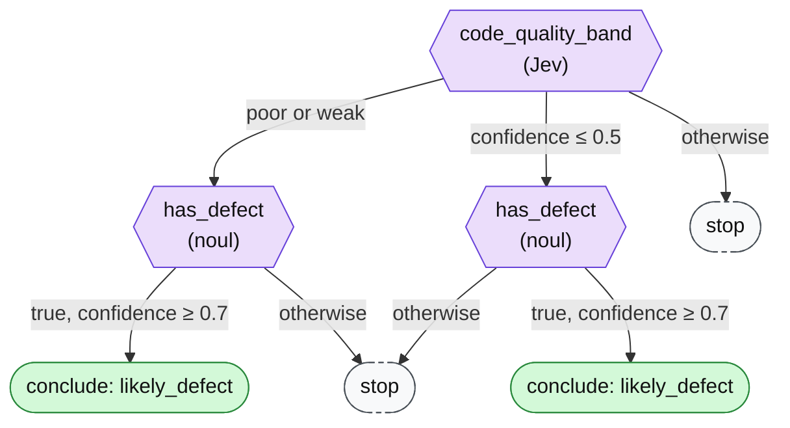

# Happy path sequences

From spike 010. Components and rules are in `README.md`. The examples use the reference workflow (`docs/definitions/sdlc-reference.yaml`), but the engine only sees neutral concepts: stages, transitions, checkpoints, steps, evidence, and action names. Spike 011 fixed the driver API contract: operations, schemas, and a full run as calls are in `docs/driver-api/`.

MCP calls go through the MCP gateway, which forwards them with the caller's driver token to the engine's HTTP driver API (Q20). Hooks call that API directly. Every mutating call carries an idempotency key. Every request on a run locks the run's row for its transaction, and writes its state change and events together.

## 1. Start and bind

- An unknown session is registered lazily on its first PreToolUse (spec 005). Forks and `/clear` bind again (spec 006).
- A second run in a bound session is refused. Another user's binding is refused unless the owner takes over the lease in the UI (Q14).

## 2. Push work to git

Git is the evidence channel (Q26). The driver submits no evidence in the reference workflow. It commits, pushes, and names the revision in its next transition request. The runner reads everything else from git at that revision. `submit_evidence` stays in the driver API for workflows whose content does not live in git.

## 3. Request a transition and run its checkpoint

The `approve_release` transition's checkpoint, with runner checks, an evaluator council with a shadow typed decision, and a human step. Steps run strictly in order and fail fast. The engine moves the attempt forward on each runner result it polls, each deadline, and each human decision.

Outcomes that change the flow:

- A step *failed*: the attempt ends, and `status` carries the reason. The driver reworks and requests the transition again.
- A step *not evaluated* (the runner could not run, a council member could not run, or a deadline passed): the attempt does not pass (fail closed), with no deduction (spec 003 Q27).
- A shadow typed decision that fails or is truncated is *not evaluated* for that decision only, and never affects the checkpoint.

## 4. Authorize a protected action

The engine never sees the command. Any tool call the kit does not map passes through as ordinary activity. GitHub branch protection stays the real gate.

## 5. Correlate telemetry

Runner evaluator usage arrives in the job result, not through the collector. DecisionEngine calls are not exported through OTel: the engine records each call attempt in its own table (spike 008).

## 6. Exhaustion escalation and rework

## 7. Propose and publish a definition version

## 8. Publish events to analysis

Every state change in the sequences above also writes its events, and an outbox row for each, in the same transaction (Q23).

Rebuilding the analysis store (a new measure, or a reset): analysis clears its projections and reads the engine's paged event read from the start, then continues from the broker. The broker keeps messages for a limited time, so it is not the source for a rebuild.

## 9. A shadow decision tree

The tree the reference workflow declares on `code_quality` (Q28). `typed-decisions` walks it inside the shadow branch of sequence 3.

Branches are checked in order and the first match wins, so a `weak` answer with low confidence takes the first branch. Every node is recorded, and conclusions are shown in the quality view and change nothing in the run.
