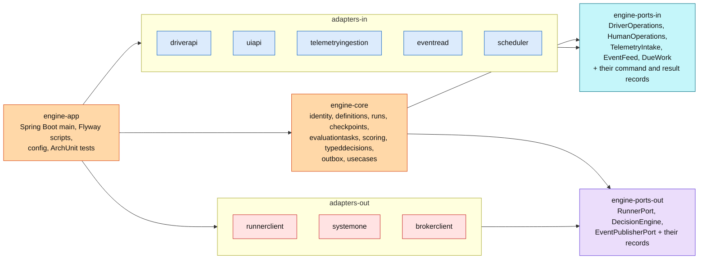
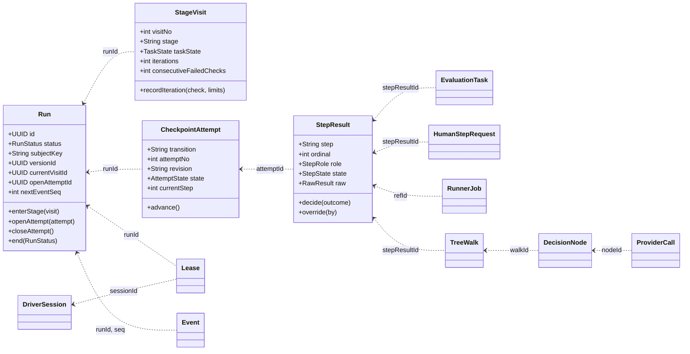
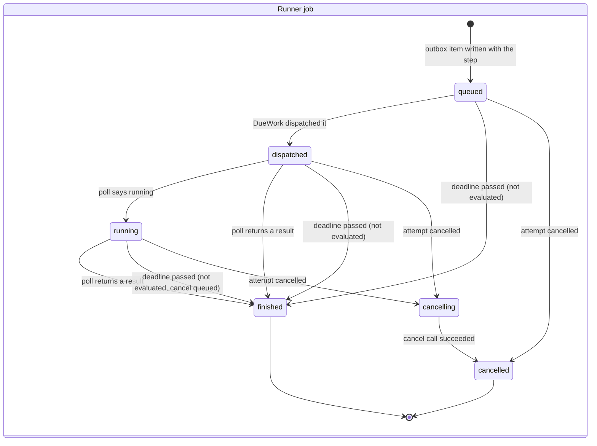
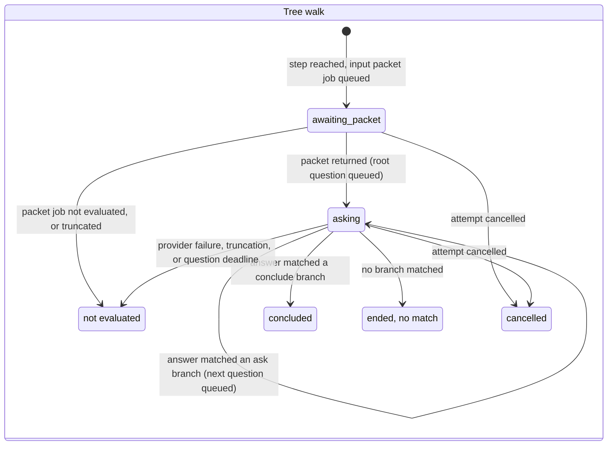
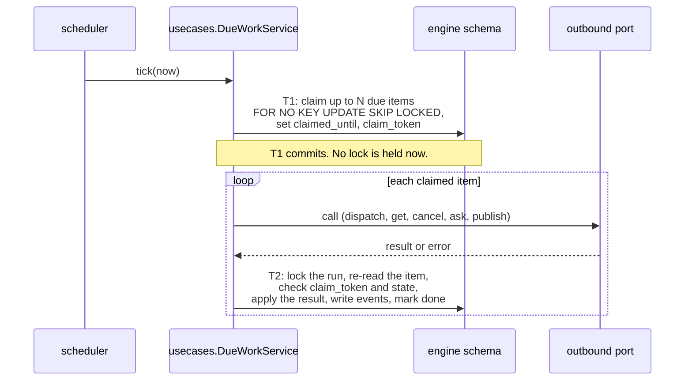
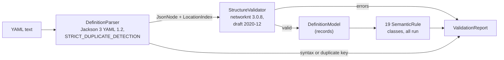

# Engine low-level design

From spike 013 (`specs/013-engine-low-level-design/`), where every decision is in the Log (Q1–Q13). It turns the engine part of the target architecture (`docs/architecture/`, AD-1 to AD-29) into a design the Phase 1 engine specs can implement directly, on the stack chosen by spike 012: Java 25, Spring Boot 4.1, Maven, JPA / Hibernate 7.4 on PostgreSQL 18, Flyway, and ArchUnit. The driver contract is `docs/driver-api/`. Terms are in `docs/concepts/glossary.md`, and the lifecycles in `docs/concepts/model.md`.

The draft schema is `schema-draft.sql`, next to this file.

## Contents

1. Maven modules and packages
2. Ports
3. Domain model
4. Schema
5. State machines
6. Transactions and concurrency
7. Definition validator
8. Errors and denials
9. Testing
10. Changes this design makes to other documents

## 1. Maven modules and packages

One deployable (AD-1), built from one Maven reactor under `engine/` with six modules. The ports, the core, and the adapters are separate modules, so an adapter cannot reach the core, the core cannot reach an adapter, and no adapter library (Spring Web, the HTTP clients, the Pub/Sub client) is on the core's classpath. The adapters are grouped into one inbound and one outbound module, each adapter a package (Q17). The core is one module with a package per core module (Q2). ArchUnit checks the rules inside the core and between adapter packages.



Boxes inside `adapters-in` and `adapters-out` are packages, not Maven modules.

| Maven module | Depends on | Holds |
| --- | --- | --- |
| `engine-ports-in` | nothing (JDK only) | The five inbound port interfaces, their command and result records, `Outcome`, `Denial`, `DenialCode` |
| `engine-ports-out` | nothing (JDK only) | `RunnerPort`, `DecisionEngine`, `EventPublisherPort` and their records |
| `engine-core` | both port modules; Spring, Spring Data JPA, Jackson, networknt | Every rule and all state: entities, repositories, module services, the `usecases` package that implements the inbound ports |
| `adapters-in` | `engine-ports-in`; Spring Web, Spring scheduling | One package per inbound adapter (`driverapi`, `uiapi`, `telemetryingestion`, `eventread`, `scheduler`): HTTP or timer mapping, contract records (hand-written, spec 012 Q13), denial-to-HTTP mapping |
| `adapters-out` | `engine-ports-out`; an HTTP client, `google-cloud-pubsub` | One package per outbound adapter (`runnerclient`, `systemone`, `brokerclient`), each implementing one port |
| `engine-app` | everything | `@SpringBootApplication`, Flyway scripts (`db/migration/engine`), `application.yaml`, ArchUnit tests |

This refines spike 012's "Maven modules per core, port, and adapter" (Q17). Grouping keeps the property that matters, a core that cannot see adapters or their libraries, with four modules instead of ten. What it gives up: the compiler no longer stops one adapter from using another adapter's classes or libraries inside the same group, so ArchUnit checks that.

The base Java package is a placeholder, `aiworkflow.engine`, to settle at scaffolding. Packages follow modules: `aiworkflow.engine.core.runs`, `aiworkflow.engine.port.in`, `aiworkflow.engine.adapter.in.driverapi`, `aiworkflow.engine.adapter.out.brokerclient`, and so on.

### Inside the core

Each core module is a package. Its entities, repositories, and services are package-private where Java allows; what other modules may call is a small `public` service class per module. A ninth package, `usecases`, implements the inbound ports: one class per port, which runs each use case's frame (authenticate, idempotency, lock, delegate, events, commit) and calls the module services. Modules never call `usecases`.

Allowed calls between core packages, which ArchUnit checks (the arrows follow the "Calls" column of `docs/architecture/README.md`, with one change):

| Package | May call |
| --- | --- |
| `usecases` | every module; outbound ports (only in the no-lock phase of `DueWork`, section 6) |
| `checkpoints` | `definitions`, `runs`, `evaluationtasks`, `scoring`, `outbox`, `typeddecisions` |
| `typeddecisions` | `definitions`, `runs`, `outbox` |
| `evaluationtasks` | `definitions`, `outbox` |
| `runs` | `definitions` |
| `identity`, `definitions`, `scoring`, `outbox` | nothing in the core |

The change: the architecture has `outbox + deadlines` calling `checkpoints` with results and calling `RunnerPort` and `EventPublisherPort`. That makes a cycle with `checkpoints`, and it would put an external call inside a module's transaction. Here `outbox` only stores items and answers what is due. `usecases.DueWorkService` claims them, calls the outbound port with no lock held, and hands the result to `checkpoints` or `typeddecisions` (Q1). The core still runs no threads: the `scheduler` calls `DueWork.tick()`, which works through due items one by one.

### How the rules are checked

| Rule (`docs/architecture/README.md`) | Checked by |
| --- | --- |
| Inbound adapters depend only on inbound ports | Maven: the only engine dependency of `adapters-in` is `engine-ports-in` |
| Adapters do not use each other | ArchUnit: no package in `adapter.in..` or `adapter.out..` depends on another adapter package |
| Core depends only on itself and the ports | Maven: `engine-core` does not depend on `adapters-in` or `adapters-out`, so it cannot see their libraries either |
| Each outbound adapter depends only on its port | Maven: the only engine dependency of `adapters-out` is `engine-ports-out`; ArchUnit: each adapter package uses only its own port's package |
| No transitive leaks | `maven-dependency-plugin` 3.11.0 `analyze-only`, `failOnWarning=true`, in every module |
| No SDLC, git, or Claude Code names in the core or ports | ArchUnit over class, package, and member names in `engine-core` and both port modules, matching camel-case word parts (`Git`, `Claude`, `Sdlc`, `Merge`, `PullRequest`), not substrings (Q15) |
| Broker product only in `brokerclient` | Maven keeps it out of the core and `adapters-in`; ArchUnit: no class outside `adapter.out.brokerclient` depends on `com.google.cloud.pubsub..` |
| No JPA types in port signatures | ArchUnit: port modules do not depend on `jakarta.persistence..` or on core classes (Maven also prevents the latter) |
| Allowed calls between core packages, no cycles | ArchUnit `layeredArchitecture()` and `slices().should().beFreeOfCycles()` over `core..` |
| Pure rule code stays pure | ArchUnit: classes in `core..rules` subpackages (state move tables, pass conditions, median, tree branch matching, scoring, semantic rules) do not depend on `jakarta.persistence..`, `org.springframework..`, or entities (Q18) |

ArchUnit tests sit in `engine-app`, the only module that sees every class. ArchUnit reads names, not string literals, so a provider name in a string (for example `jev` in a test fixture) is not caught; the definition holds those by design (rule 12). The planted-violation trial (`specs/013-*/prototype/module-rules/`) confirmed every row: each planted violation failed the build at the expected tool, and only string literals passed. The trial used one module per adapter; with grouped adapters, the cases it caught at compile time between adapters (one outbound adapter importing another) move to the ArchUnit rule "Adapters do not use each other", which works like the core cycle rule it did test.

Build rules the trial found:

- `analyze-only` with `failOnWarning` cannot be used with Spring Boot starters or the `archunit-junit5` aggregator, which hold no classes. Modules declare the real artifacts (`spring-web`, `spring-context`, `spring-boot-autoconfigure`, `archunit`, `archunit-junit5-api`).
- `engine-app` wires modules by component scan, so it sets `ignoredUnusedDeclaredDependencies` for its sibling modules (five with grouped adapters) and the ArchUnit JUnit engine. "Used undeclared" is still checked there.
- One `engine-ports-out` module (Q14) and grouped adapters (Q17): ArchUnit catches an outbound adapter using another adapter's port or classes.
- The repository carries its own Maven settings, pointing at Maven Central (Q16), and pins JDK 25 for the build, since a newer JDK may be the machine's default.

## 2. Ports

Inbound ports own their command and result records (Q3). They are plain Java records and sealed interfaces in `engine-ports-in`, with no JPA, Jackson, or Spring types. The inbound adapters map the contract's JSON to them, so entities never leave the core and the contract can change shape without touching the core.

```java
public sealed interface Outcome<T> permits Outcome.Ok, Outcome.Denied {
  record Ok<T>(T value) implements Outcome<T> {}
  record Denied<T>(Denial denial) implements Outcome<T> {}
}
public record Denial(DenialCode code, String message, String recovery, Map<String, Object> details) {}
public enum DenialCode { SESSION_UNKNOWN, RUN_NOT_FOUND, NOT_PERMITTED, ATTEMPT_OPEN, STALE_PRECONDITION,
  SUBJECT_BUSY, LEASE_HELD, ACTION_NOT_ALLOWED_IN_STAGE, REVISION_NOT_REVIEWED, STAGE_TASK_EXHAUSTED,
  MISSING_CAPABILITY, FORBIDDEN_SCOPE, INVALID_INPUTS, VALIDATION_FAILED, IDEMPOTENCY_CONFLICT }

public record Caller(String credential, CredentialKind kind) {}          // raw bearer token or session cookie
public record Idempotency(String key, byte[] requestHash) {}             // the adapter hashes the canonical body

public interface DriverOperations {
  Outcome<Registered>       registerSession(Caller c, Idempotency k, RegisterSession cmd);
  GateDecision              gate(Caller c, Idempotency k, GateRequest cmd);  // always a decision, never Denied
  Outcome<Accepted>         recordActivity(Caller c, Idempotency k, Activity cmd);
  Outcome<IterationVerdict> reportIteration(Caller c, Idempotency k, Iteration cmd);
  Outcome<StatusView>       status(Caller c, StatusQuery q);
  Outcome<StatusView>       startRun(Caller c, Idempotency k, StartRun cmd);
  Outcome<TransitionResult> requestTransition(Caller c, Idempotency k, RequestTransition cmd);
  Outcome<DefinitionView>   getDefinition(Caller c, DefinitionQuery q);
  Outcome<DraftCreated>     submitDraft(Caller c, Idempotency k, SubmitDraft cmd);
}
public interface DueWork { TickReport tick(Instant now); }
```

`HumanOperations`, `TelemetryIntake`, and `EventFeed` follow the same pattern. Each method is one use case. A port takes the raw credential and authenticates it in the core (`identity`), so adapters hold no authorization logic.

`StatusView` is a record tree that mirrors the contract's `Status`, and `driver-api` maps it one to one. Its enums (`RunStatus`, `StepState`, and so on) live in `engine-ports-in` and are the same enums the core's entities use (section 5), so a state cannot be renamed or merged between storage and the API without a compile error.

Outbound ports, in `engine-ports-out`:

```java
public interface RunnerPort {
  void dispatch(RunnerJobId id, JobPacket packet);     // idempotent by id
  RunnerJobState get(RunnerJobId id);                  // Pending | Running | Finished(result)
  void cancel(RunnerJobId id);
}
public interface DecisionEngine {
  DecisionAnswer ask(DecisionQuestion q);              // Answered(...) | NotEvaluated(reason, usage)
}
public interface EventPublisherPort {
  void publish(String orderingKey, List<PublishedEvent> batch);
}
```

`DecisionAnswer` carries each attempt's call record (model, tokens, duration, error type, provider request ID), so `typeddecisions` writes the `provider_call` rows. The adapter only returns them. This settles the mismatch between spec 008 ("the adapters write the table") and the architecture (`typed-decisions` owns it) in favour of the architecture.

## 3. Domain model

The `run` row is the aggregate root, the lock, and the consistency boundary (Q4). Every other run-side entity is a separate JPA entity with its own repository, referring to the run by ID. There are no bidirectional collections and no cascades from `Run`. Each use case loads what it needs explicitly after it has locked the run. This keeps each call's reads visible in the code and stops a use case from loading a run's whole history.



| Module | Entities | Invariants it guards (all under the run lock) |
| --- | --- | --- |
| `identity` | `Workspace`, `User`, `RoleAssignment`, `HumanAccount`, `HumanSession`, `DriverToken` | One live driver token per user; driver credentials never carry approval scopes (Art. 2) |
| `definitions` | `Workflow`, `DefinitionVersion`; the parsed `DefinitionModel` (records) | Published versions are immutable; one published version per workflow; numbers are sequential |
| `runs` | `Run`, `StageVisit`, `Iteration`, `Escalation`, `DriverSession`, `Lease`, `Evidence`, `Event`, `IdempotencyRecord`, `TelemetryRecord` | One active run per workflow and subject key; one current visit; at most one active lease; at most one open escalation; a gapless event sequence per run |
| `checkpoints` | `CheckpointAttempt`, `StepResult`, `HumanStepRequest`, `Override` | At most one open attempt per run (`run.open_attempt_id`); steps strictly in order (`current_step`); fail fast; *not evaluated* never becomes *passed*; an override keeps the raw result; separation of duties |
| `evaluationtasks` | `EvaluationTask` | Council members are numbered 1..N; a late result for a closed task is rejected |
| `outbox` | `RunnerJob`, `OutboxItem`, `Deadline` | Every runner job has a deadline (AD-6); a claimed item is applied once (claim token) |
| `typeddecisions` | `TreeWalk`, `DecisionNode`, `ProviderCall`, `InputPacket` | Path at most 3 questions; a *not evaluated* answer ends the walk; nothing it records changes the run (shadow) |
| `scoring` | `RunScore` | Only place a score is computed (Art. 1) |

Rules that apply to every entity:

- Entities are JPA classes with no public setters. State changes go through methods that check the state machine (section 5) and the invariant, for example `StepResult.decide(outcome)`.
- The definition a run pinned is read as an immutable `DefinitionModel` record tree, parsed once from `definition_version.parsed` and cached by version ID. No entity holds definition content beyond IDs and copied limits.
- The rules that compute something (pass conditions, council median, tree branch matching, scoring) are pure functions on records, with no JPA or Spring, in a `rules` subpackage of their module (for example `core.scoring.rules`). An ArchUnit rule keeps them pure (Q18). The same functions serve the live use cases and the replay check (section 9).
- A lease and its driver session are separate entities: a session can exist unbound, and a run keeps the history of every lease holder for events and separation of duties.
- A transition request is not its own table. A guarded request becomes a `CheckpointAttempt`. An unguarded one commits at once and is recorded by its events. A denied one is an audit event only (Q6).
- Evidence stays in the model and the schema for workflows whose content is not in git. The reference workflow submits none (AD-27).

## 4. Schema

The draft DDL is `schema-draft.sql`. It becomes the engine's Flyway `V1__engine.sql`. Analysis has its own schema and its own scripts (spec 012 G3).

- **Keys.** Every row has an app-generated UUIDv7 (Hibernate `@UuidGenerator(style = VERSION_7)`), so IDs are known before insert, sort by time, and fit a Kubernetes Job name: `rj-` plus the lowercase UUID is 39 characters (Q9).
- **Event order.** `event.seq` is gapless per run, taken from `run.next_event_seq` under the run lock, and unique on `(run_id, seq)`. Replay reads a run's events by `seq`. `event.position` is a global identity column used only to page `EventFeed`.
- **Lifecycle columns** are `text` with check constraints that list exactly the Java enum's values. A Flyway migration and the enum change together.
- **Document columns** (`jsonb`, AD-23): the parsed definition, run inputs, event payloads, evidence payloads, raw step results, packets, runner results, provider distributions, and score breakdowns. Everything that a query filters or joins on is an ordinary column.
- **Unique constraints that carry rules:** `one_active_run` (partial, `status = 'active'`), `one_current_version`, `one_active_lease`, `one_open_escalation`, `one_live_driver_token`, `(run_id, seq)` on events, `(attempt_id, ordinal)` on step results, and `(principal, key)` on idempotency records.
- **Mapping.** `jsonb` columns map to Java records through Hibernate's `Jackson3JsonFormatMapper`, built from Boot's `JsonMapper` in a `HibernatePropertiesCustomizer`. Hibernate's default instance uses its own mapper and writes `Instant` as epoch seconds; Boot's writes ISO-8601 (lock prototype).
- **Migrations.** Flyway SQL scripts only, `ddl-auto=validate` at startup, forward-only, no Java migrations. A migration that changes an enum's check constraint ships with the enum change.
- **Replay data.** An operational value that affects an outcome is written into the event that records the outcome and into the row's `settings` column (`step_result.settings`, `runner_job.settings`): the evaluator timeout, the deadline margin, and the provider model. Replay reads only events.

Event payloads, by kind (each event also has the common columns):

| Event type | Payload needed for replay |
| --- | --- |
| `run_started` | workflow, version, subject key, run inputs, owner, entry stage, visit 1 limits |
| `session_bound`, `lease_acquired`, `lease_released` | session, user, reason |
| `iteration_recorded` | visit, n, criteria met, unmet, verdict, counters after |
| `stage_task_exhausted`, `escalation_resolved` | visit, limit hit, owner's choice, new limits |
| `transition_committed` | transition, from, to, rework flag, revision, attempt (if any), new visit |
| `attempt_opened`, `attempt_closed` | attempt, transition, attempt number, revision, state |
| `step_result_recorded` | attempt, step, ordinal, state, raw result, reason, settings |
| `step_overridden`, `human_step_decided` | step, user, decision, reason |
| `evaluation_task_closed` | task, member, state, raw score, band |
| `decision_recorded` | walk, node, question, label, confidence, branch, conclusion, model |
| `run_ended` | status, classification |
| `action_authorized` | action, revision, session |
| `gate_denied`, `transition_denied` (audit only) | the request and the denial |

## 5. State machines

Each lifecycle is a Java enum in `engine-ports-in` with an explicit table of allowed moves. An entity changes state only through `transitionTo(next)`, which throws `IllegalStateException` for a move the table does not allow. That is a bug, never a denial: the use case checks the business rule first and returns a denial when it fails. No state machine library: the machines are small, and a table plus exhaustive `switch` expressions over the enums keeps them visible and makes the compiler find every place a new state must be handled.

```java
public enum StepState {
  PENDING, RUNNING, PASSED, FAILED, NOT_EVALUATED, OVERRIDDEN;
  private static final Map<StepState, Set<StepState>> NEXT = Map.of(
    PENDING, EnumSet.of(RUNNING, PASSED, FAILED, NOT_EVALUATED),
    RUNNING, EnumSet.of(PASSED, FAILED, NOT_EVALUATED),
    FAILED,  EnumSet.of(OVERRIDDEN),
    PASSED, EnumSet.noneOf(StepState.class), NOT_EVALUATED, EnumSet.noneOf(StepState.class),
    OVERRIDDEN, EnumSet.noneOf(StepState.class));
  public boolean canMoveTo(StepState next) { return NEXT.get(this).contains(next); }
}
```

The run, stage visit, definition version, checkpoint attempt, step result, evaluation task, and human step request follow the diagrams in `docs/concepts/model.md`, with these guards:

| Machine | Move | Guard (checked by the use case before the move) |
| --- | --- | --- |
| Run | `active → completed / failed` | The committed transition enters a success or failure terminal stage |
| Run | `active → abandoned` | A human owner in the UI; open attempt, jobs, tasks, and human requests are cancelled in the same transaction |
| Stage visit | `working → exhausted` | A limit reached before criteria met; opens an escalation |
| Stage visit | `exhausted → working` | The owner extends the budget; new limits are recorded |
| Attempt | opened (`running`) | Transition permitted from the current stage, no open attempt, `expected_attempts` matches, lease held, task not exhausted |
| Attempt | `running → passed` | Every step has a result and no required step is `failed` or `not_evaluated` |
| Attempt | `running → failed` | A required step failed; the remaining steps become `not_evaluated` |
| Attempt | `passed → accepted` | Same transaction: transition committed, new visit, score recomputed |
| Step result | `failed → overridden` | Required step, human session, separation of duties, not a human step's rejection |
| Definition version | `draft → published` | A human approver; the previous published version becomes `superseded` in the same transaction |

An attempt where a required step is `not_evaluated` and none `failed` ends `failed` with `last_decision.kind = attempt_not_evaluated`, costs no deduction, and can be retried (`docs/definitions/schema.md` "Scoring rules").

Two machines had no diagram yet:



`finished` carries an `outcome` (`passed`, `failed`, `not_evaluated`) classified by the runner (AD-13) or set to `not_evaluated` by the engine deadline. A poll result that arrives after `finished` or `cancelled` is dropped.



Each `DecisionNode` is `asking → answered | not_evaluated`. A walk never moves the checkpoint attempt: the attempt does not wait for it (AD-17).

## 6. Transactions and concurrency

### The use-case frame

Every inbound port call that reaches a run follows one frame, in one transaction (AD-16, AD-25), in `usecases`:

1. **Authenticate** through `identity` (hash the bearer token, look it up). A failure is `401` in the adapter, before any write.
2. **Idempotency** (mutating calls only): insert `(principal, key)` into `idempotency_record` (section "Idempotency" below).
3. **Lock the run** with `SELECT … FOR NO KEY UPDATE` (Spring Data `@Lock(PESSIMISTIC_WRITE)` on a `findByIdForUpdate` method). Calls that create a run (`start_run`) lock nothing and rely on `one_active_run`.
4. **Load and check.** Read what the use case needs, check the rules, and return `Denied` on the first rule that fails.
5. **Write** state through the entities, and append events through `runs.EventLog`, which takes `seq` from the locked run. Write outbox items and deadlines through `outbox`.
6. **Commit.** Hibernate flushes state, events, and outbox items together.

Lock order is always: idempotency key, then the run, then the run's child rows. No code path locks a child row and then its run inside one transaction. `DueWork`'s claim transaction locks only outbox, deadline, or runner job rows and never a run (below), so it cannot deadlock with a use case.

`FOR NO KEY UPDATE` is enough for every use case. It blocks every other use case on the same run, but not the `FOR KEY SHARE` locks that foreign key checks take, so inserting events, outbox items, and child rows that reference the run is not blocked. `FOR UPDATE` would be needed only to delete a run or change its primary key, which never happens. Changing `run.status` is allowed under it, because `one_active_run` is a partial index. The lock prototype confirmed all of this: Hibernate 7.4.5 emits `for no key update of r1_0`, child inserts under it take 2–3 ms while `FOR UPDATE` blocks them, and only a primary key change or a run delete escalates.

### External calls: three phases

Calls to the runner and to Jev never happen while a run is locked (Q1). Jev calls can take up to 30 s with retries, and a held lock would stall the `gate` past the hook's 8 s limit, which fails closed and blocks the agent. A use case that needs an external call writes an outbox item. `DueWork.tick()` then handles each due item in three phases:



- **Phase 1** claims items with `FOR NO KEY UPDATE SKIP LOCKED` and sets a claim lease (`claimed_until`, `claim_token`), then commits. Several engine replicas can tick at once and never claim the same item (Q10). The MVP runs one replica.
- **Phase 2** calls the outbound port with no transaction open.
- **Phase 3** is a normal use-case frame. It locks the run, checks that the item still carries this claim token and that its target is still open (the attempt may have been cancelled meanwhile), applies the result through `checkpoints` or `typeddecisions`, and marks the item done. A result that is no longer wanted is dropped and recorded.
- **Failure.** If phase 2 fails, phase 3 records the error and sets `due_at` with backoff. If the engine dies between phases, the claim lease expires and the item is claimed again. Every call is safe to repeat: dispatch by Job name, cancel by Job name, publish by event ID, and a repeated Jev question is one more `provider_call` row.
- **Deadlines** use the same phases: claim due deadline rows, then in phase 3 lock the run and record *not evaluated* if the work has not finished (and queue a cancel for a runner job).
- **Polling** uses the `runner_job_poll` index the same way: claim running jobs whose `next_poll_at` has passed.
- **Publishing** claims `publish_event` items in `(run_id, ordering)` order and publishes each run's batch with the run ID as ordering key. Phase 3 does not lock the run; it only marks items done. Commits on one run are serialized by the run lock, so a run's events become visible in `seq` order.

`DueWork.tick()` is therefore one port call that runs several short transactions. This refines AD-25 ("one transaction per port call") for `DueWork` only: one transaction per due item and phase.

### Idempotency

`Idempotency-Key` handling is in the core, not a servlet filter, because adapters may not touch storage. The adapter passes the key and a SHA-256 of the canonical request body (`Idempotency` record); the core does the rest in the use case's transaction:

1. Insert `(principal, key, operation, request_hash)` with `ON CONFLICT (principal, key) DO NOTHING`. If another transaction holds the same key, PostgreSQL makes this insert wait until that transaction ends. A plain `INSERT` would abort the whole transaction on conflict.
2. If the insert inserted nothing, a committed row exists: compare `request_hash`. A different hash is `idempotency_conflict`. The same hash returns the stored `response`, with no other work.
3. Otherwise run the use case. On success, store the result record as `response` and commit.
4. On a denial, delete the row in the same transaction before commit, so the denial is never stored (Q5). A waiting retry then runs the use case again against current state. Audit events for gate and transition denials still commit (Q6).

A request that is still running is not answered `409`, as draft -07 suggests: the retry simply waits for the first transaction, which is short. Records older than 7 days are deleted by `DueWork` (Q13). Read-only calls (`status`, `get_definition`) take no key.

### JPA rules

- Each use case writes through JPA only, in one persistence context, and commits once. Hibernate flushes in its own action order (inserts, updates, deletes), not in call order; within one transaction the order does not matter, because nothing outside sees the writes before commit.
- No `JdbcClient` statement inside a use case after an entity change: `JdbcClient` never flushes the session and reads stale rows, and mixed JDBC and JPA writes gave a false replay mismatch in the lock prototype. Hibernate's auto-flush is no guard either: JPQL flushes only when it touches an overlapping table, and any native query through the `EntityManager` flushes the whole session. `JdbcClient` is used only for phase-1 claims and the idempotency insert, both before any entity change in their transaction.
- The replay check runs in its own read-only transaction, after commit, so session state cannot hide anything from it.
- Entities carry no `@Version` column: the run lock already serializes writers, and optimistic locking would only add retries.

## 7. Definition validator

In `core.definitions.validation`. It runs on `submit_draft` and when a definition file is loaded, and stores nothing unless the definition is valid.



- **Order** (Q11). Parse, then the structure layer. Only if the structure is valid, build the `DefinitionModel` records and run all 19 semantic rules, collecting every error. A YAML syntax error or a duplicate key stops at parsing.
- **Location.** `LocationIndex` maps each JSON pointer to a line and column, built from the YAML token stream (spec 012's parsing trial, about 30 lines).
- **Schema file.** The published JSON Schema lives at `definitions/schema/ai-workflow-v0.schema.json` in the repository, with `$id` `https://ai-workflow/schema/v0`. The engine build copies it onto the classpath and maps the `$id` to it, so validation never fetches anything.
- **Rules.** One class per rule, `Rule01UniqueIds` to `Rule19SubjectKey`, each implementing:

```java
interface SemanticRule {
  int number();
  List<ValidationError> check(DefinitionModel model, LocationIndex where);
}
record ValidationError(Layer layer, Integer rule, String keyword, String pointer,
                       int line, int column, String message) {}   // Layer: SYNTAX, STRUCTURE, SEMANTIC
```

- **Report.** A failure is `Denied(VALIDATION_FAILED)` with `details.errors` listing every `ValidationError`, which the `validation_failed` denial returns (`docs/driver-api/README.md`).
- **Fixtures.** `engine-core/src/test/resources/definitions/invalid/`, one file per rule named `rule-NN-<slug>.yaml`, plus `structure-*.yaml` and `syntax-*.yaml`. Each is the reference definition with one change, and a parameterized test checks that it yields exactly one error with the expected layer, rule, and pointer. The 12 fixtures in `docs/definitions/schema.md` cover rules 2, 3, 4, 5, 8, 9, 10, 11, 17, and 19 and the structure layer. Milestone 1 adds one each for rules 1, 6, 7, 12, 13, 14, 15, 16, and 18, and a duplicate key.
- **Valid fixtures.** `sdlc-reference.yaml` and the toy article workflow from `docs/concepts/model.md` must both pass.

## 8. Errors and denials

- **Denials are values.** A broken business rule returns `Outcome.Denied` from the port. The core throws only for bugs (an illegal state move) and infrastructure failures (database down). Denials are never exceptions, so the type system forces each adapter to handle them.
- **Mapping.** `driver-api` maps `DenialCode` to HTTP status with the table in `docs/driver-api/README.md` and writes RFC 9457 `application/problem+json` through Spring's `ProblemDetail`, with `code`, `message`, `recovery`, and `details` as properties. The gate returns `200` with `decision: deny`. `ui-api` uses the same mapping.
- **Unexpected failures** are `500` (a bug) or `503` (database or dependency unavailable), with a problem body and no denial code. The MCP gateway and the hooks treat both as failures and fail closed (Art. 10).
- **Messages.** Each `DenialCode` has one message and recovery template in the core, filled with the specifics, for example "Revision 9f3c… was not reviewed; the last passing checkpoint reviewed 41ab…". The text is generic; workflow words come from the definition (stage, transition, and action names).
- **Audit.** Gate and `request_transition` denials append an `audit_only` event in their transaction (Q6). Other denials are logged, not recorded.
- **Three outcomes, end to end** (Art. 7). `StepState` and `RunnerOutcome` keep `NOT_EVALUATED` distinct from `FAILED` in the enum, the check constraint, the event payload, and the API. Code that decides anything from them uses an exhaustive `switch` with no `default`, so a new state is a compile error. The scoring function takes *not evaluated* explicitly: no points earned and no deduction. ArchUnit cannot see `default` branches in bytecode, so the review checklist and a unit test per switch site cover that.

## 9. Testing

| Layer | What | How |
| --- | --- | --- |
| Pure rules | State machine tables, pass conditions, council median, tree branch matching, scoring, template rendering | Plain JUnit 5, no Spring, no database |
| Validator | Each semantic rule and fixture, the location mapping | JUnit 5 over the fixture directory, no Spring |
| Core use cases | Each port's use cases, called through the port interface, without HTTP | Spring context of `engine-core` plus Flyway, Testcontainers PostgreSQL 18 (one reused container), in-memory fakes of `RunnerPort`, `DecisionEngine`, and `EventPublisherPort`, and a fixed clock |
| Concurrency | Two use cases on one run serialize; same idempotency key; `DueWork` claims with two ticks at once; deadline versus result races | Core tests with two threads and latches, from the spike's lock prototype |
| Inbound adapters | Request and response mapping, denial to status, problem bodies | MockMvc with a mocked port; every response validated against the contract's JSON Schema files with networknt (spec 012 Q12) |
| Outbound adapters | `runner-client` and `systemone` against recorded responses; retries and *not evaluated* mapping | WireMock with spec 008's captures; `broker-client` against the Pub/Sub emulator in Testcontainers |
| Module rules | Section 1 | ArchUnit in `engine-app`, `analyze-only` in every module's build |
| Scenarios and replay | Test-bed runs T01 (happy path), T05 (rework), T06 (failed checkpoint), T07 (override) as scripted port calls | Core tests with fakes; after each, the replay check rebuilds state and score from events and must report no difference (milestone 2) |

**The replay check** (Q12) is a core service, `runs.ReplayCheck`, that reads one run's events by `seq` in a read-only transaction, folds them into records (visits, attempts, step results, leases, decisions, score) with the same pure functions the use cases use, and compares them with the tables. It runs in every scenario test and on demand for one run from the UI API (an admin action). It skips `audit_only` events and telemetry.

Every acceptance criterion of a Phase 1 spec maps to one of these tests (Art. 11).

## 10. Changes this design makes to other documents

To apply when the spike closes (`/sdd-verify 013`):

- `docs/driver-api/README.md` Status: `run.state` becomes `active | completed | failed | abandoned`, plus `run.classification: provisional | scored | overridden | excluded`; `open_attempt.steps[].state` gains `overridden` (Q7).
- `docs/architecture/README.md`: the `definitions` row says 19 semantic rules, not 18; `outbox + deadlines` no longer calls `checkpoints` or the outbound ports, `usecases` does (section 1); `DueWork` runs one transaction per due item and phase (Q1).
- `docs/architecture/decisions.md`: AD-25 notes the three-phase exception for `DueWork`; AD-16 notes that only committed results are stored under an idempotency key and that an in-progress retry waits instead of getting `409`.
- `specs/008-jev-telemetry/spec.md` needs no edit; the architecture's reading (`typed-decisions` writes the provider call table) is the one in force.
