# 015 · Plan: CI pipeline and branch protection

## Approach

The repository checks live in one shell script, `.github/scripts/repo-checks.sh`, which runs the same way on a laptop and in CI. A GitHub Actions workflow runs it in one job, `repo-checks`, on every pull request to `main` and every push to `main`. A self-test script plants each defect in a scratch copy of the repository and confirms that the matching check fails, then passes once the defect is gone.

The merge rules are kept as code: a ruleset file in `.github/rulesets/main.json` and the repository merge settings, both applied by an idempotent script with a `--verify` mode that compares GitHub's live state with the file. Keeping the rules in the repository means every change to them shows up in a pull request diff, where `sdd-reviewer` flags it (R15).

The work itself lands through the pipeline it builds. The branch is pushed and opened as a pull request once the workflow exists. The ruleset is applied while that pull request is open, so this spec's own pull request is the first one merged under the new rules. The failure cases are then tried on throwaway branches and pull requests.

`sdd done` also regenerates `specs/STATUS.md`. It ticks tasks through the script, not through the Edit tool, so the hook that keeps `STATUS.md` current never fires for it. Without the fix, the status check (R4) would fail every pull request in which a task was ticked.

## Constitution check

| Article | How the plan complies |
| --- | --- |
| 4. Drivers stay subscription-compatible | The workflow runs shell, Python, and jq only. It holds no model credentials and calls no model (R6, AC-6). |
| 5. Fail closed | An unknown or missing required check leaves a pull request pending, which blocks the merge. No path filters, because a filtered-out required check stays pending forever. |
| 8. Enforce gates off the laptop | The point of the spec. The laptop hooks stay as fast feedback; the gate is the ruleset and the checks on GitHub. |
| 10. Happy path first | Only the checks that something in the repository needs today. Engine, UI, coverage, and mutation checks come with their skeleton specs. |
| 11. Tests prove acceptance criteria | AC-3 to AC-5 are proven twice: by the self-test locally and by trial pull requests on GitHub. The rest are recorded manual checks with evidence (Test strategy). |
| 12. Small, traceable increments | Merge commits only, so each `[015] Tn` commit stays on `main`. |
| 13. Specs are living | The `STATUS.md` gap found while planning is fixed through T1, not worked around. |
| 14. Decisions are written down | Decisions table below. |
| 15. Verify current docs | Versions below were checked on 2026-11-01 by three `spike-researcher` runs; the `actions/checkout` SHA was confirmed with `git ls-remote`. |

Articles 1–3, 6, 7, and 9 are about the product and are not touched.

## Design

### Files

| Path | What it holds |
| --- | --- |
| `.github/workflows/ci.yml` | The workflow: triggers, permissions, concurrency, and the `repo-checks` job |
| `.github/scripts/repo-checks.sh` | The checks: `inventory`, `status`, `scripts`, or all three with no argument |
| `.github/scripts/test-repo-checks.sh` | Self-test: plants each defect in a scratch copy and expects the matching check to fail, then pass |
| `.github/rulesets/main.json` | The `main` ruleset, in the REST API's body format |
| `.github/scripts/apply-ruleset.sh` | Creates or updates the ruleset by name and sets the repository merge settings; `--verify` compares the live state with the file and changes nothing |
| `specs/_kit/sdd` | `sdd done` regenerates `specs/STATUS.md` after a tick |
| `specs/_kit/test-sdd-done.sh` | Self-test for `sdd done`, in a scratch git repository, including the `STATUS.md` regeneration |

### The checks

- **inventory (R3):** `python3 .claude/bom.py --check`. It already exits 1 when the generated part of `.claude/README.md` is out of date.
- **status (R4):** save `specs/STATUS.md`, run `specs/_kit/sdd status --write` with stderr captured, compare the new file with the saved one, then put the saved file back so a local run leaves the tree unchanged. It fails on a difference or on any stderr output (the board's warnings go to stderr). No git needed, so it works in the self-test's scratch copy.
- **scripts (R5):** `bash -n` on every file in `specs/_kit/`, `.claude/hooks/`, `.githooks/`, and `.github/scripts/` whose first line is a `bash` or `sh` shebang. Shebang detection catches `specs/_kit/sdd` and `.githooks/commit-msg`, which have no `.sh` suffix.

Each check prints one line, `ok <name>` or `FAIL <name>: <what to run to fix it>`. The script exits 1 if any check failed, after running all of them.

### The workflow

```yaml
name: CI
on:
  pull_request:
    branches: [main]
  push:
    branches: [main]
permissions:
  contents: read
concurrency:
  group: ${{ github.workflow }}-${{ github.head_ref || github.run_id }}
  cancel-in-progress: true
jobs:
  repo-checks:
    name: repo-checks
    runs-on: ubuntu-24.04
    steps:
      - uses: actions/checkout@3d3c42e5aac5ba805825da76410c181273ba90b1 # v7.0.1
        with:
          persist-credentials: false
      - run: .github/scripts/repo-checks.sh inventory
        name: Inventory is current
      - run: .github/scripts/repo-checks.sh status
        name: Spec board is current
      - run: .github/scripts/repo-checks.sh scripts
        name: Shell scripts parse
```

Three steps instead of one call, so a failure names its check in the pull request's checks view (AC-3 to AC-5). The job name `repo-checks` is the required check's `context`. Later specs add jobs (`engine`, `ui`) next to it.

### The ruleset and merge settings

```json
{
  "name": "main",
  "target": "branch",
  "enforcement": "active",
  "bypass_actors": [],
  "conditions": { "ref_name": { "include": ["~DEFAULT_BRANCH"], "exclude": [] } },
  "rules": [
    { "type": "pull_request", "parameters": {
        "required_approving_review_count": 0,
        "allowed_merge_methods": ["merge"],
        "dismiss_stale_reviews_on_push": false,
        "require_code_owner_review": false,
        "require_last_push_approval": false,
        "required_review_thread_resolution": false } },
    { "type": "required_status_checks", "parameters": {
        "strict_required_status_checks_policy": false,
        "do_not_enforce_on_create": false,
        "required_status_checks": [ { "context": "repo-checks", "integration_id": 15368 } ] } },
    { "type": "non_fast_forward" },
    { "type": "deletion" }
  ]
}
```

`apply-ruleset.sh` also sets, with `PATCH /repos/{owner}/{repo}`: `allow_merge_commit=true`, `allow_squash_merge=false`, `allow_rebase_merge=false`, `merge_commit_title=MERGE_MESSAGE`, `merge_commit_message=PR_TITLE`. A ruleset only narrows what the repository settings allow, so the squash and rebase buttons must be turned off there as well for the UI to offer only merge commits (AC-10). The merge commit title stays "Merge pull request #N from …", which the local `commit-msg` hook also accepts if a merge is ever made locally.

`--verify` reads the ruleset back by name and compares `enforcement`, `bypass_actors`, `conditions`, and `rules` with the file. GitHub's response may carry parameters the file leaves out, so each rule's live `parameters` are first cut down to the keys the file sets, and both sides are sorted with `jq -S`. It then checks the five repository settings, and exits 1 on any difference. `--file <path>` verifies against another file, which T10 uses to prove that `--verify` notices drift.

### How a later spec adds a check (R14)

Documented in `CONTRIBUTING.md`, section "Adding a CI check":

1. Add a job to `.github/workflows/ci.yml` with an explicit `name:`, and no path filters.
2. Open the pull request and let the job run once, so GitHub knows its name.
3. Add `{ "context": "<job name>", "integration_id": 15368 }` to `required_status_checks` in `.github/rulesets/main.json`, in the same pull request.
4. After merging, the owner runs `.github/scripts/apply-ruleset.sh` and then `--verify`.

### Ways of working (R13)

- `CONTRIBUTING.md`: a "Pull requests" section (branch, push, `gh pr create`, wait for the checks, merge with a merge commit; `main` refuses direct pushes) and the "Adding a CI check" section.
- `CLAUDE.md` Conventions: one line saying changes reach `main` only through a pull request whose required checks pass, pointing to `CONTRIBUTING.md`.
- `specs/README.md`: the same rule where commits are described.
- `/sdd-implement` step 5 and `/sdd-verify` Close: commits go on the spec's branch and reach `main` through its pull request; never push to `main`.

### Reviewer (R15)

Add to the `sdd-reviewer` checklist, for any component: a change to what CI enforces is a finding of its own, saying what got weaker or stronger. That covers `.github/` (workflow, scripts, ruleset) and the code the checks call: `.claude/bom.py`, `specs/_kit/sdd`, and `.githooks/`.

### Order of work

```mermaid
flowchart LR
  T1[T1 sdd done regenerates STATUS] --> T2[T2-T3 checks + self-test] --> T4[T4 workflow] --> T5[T5 open PR]
  T5 --> T6[T6-T7 docs, reviewer] --> T8[T8 ruleset as code] --> T9[T9 push, checks re-run]
  T9 --> T10[T10 apply ruleset] --> T11[T11 failing PR trials] --> T12[T12 push refusals] --> T13[T13 add-a-check trial]
  T13 --> T14[T14 merge spec PR] --> T15[T15 close-out PR from main]
```



T14 merges the spec's pull request, so everything after it happens on a new branch cut from `main`: ticking T14, checking the push run on the merge commit (T15), and `/sdd-verify`, which fills the Evidence rows, ticks V1 and V2, and sets the spec to `done`. That branch reaches `main` through a second, small pull request, the first one opened under the new rules from the start. `/sdd-verify` passes `sdd-reviewer` the range from the `main` commit before T14's merge to the close-out branch's head.

Trial branches in T11 and T13 are cut from the spec branch, not from `main`, because `main` has no workflow until T14. A trial cut from `main` would be refused only because its required check never reports, which proves nothing about the checks.

## Requirement coverage

| Requirement | Covered by |
| --- | --- |
| R1 | Workflow `pull_request` trigger on `main` |
| R2 | Workflow `push` trigger on `main` |
| R3 | `repo-checks.sh inventory` |
| R4 | `repo-checks.sh status`; `sdd done` regenerating `STATUS.md` keeps it from failing on every tick |
| R5 | `repo-checks.sh scripts` |
| R6 | Workflow uses checkout, shell, Python, and jq only; `contents: read`; no secrets |
| R7 | Ruleset `pull_request` rule |
| R8 | Ruleset `required_status_checks` rule, with `integration_id` 15368 so only the Actions check counts |
| R9 | Ruleset `non_fast_forward` and `deletion` rules |
| R10 | `bypass_actors: []` |
| R11 | `required_approving_review_count: 0` |
| R12 | `allowed_merge_methods: ["merge"]` plus the repository merge settings |
| R13 | `CONTRIBUTING.md`, `CLAUDE.md`, `specs/README.md`, `/sdd-implement`, `/sdd-verify` |
| R14 | `CONTRIBUTING.md` "Adding a CI check" |
| R15 | `sdd-reviewer` checklist |

## Decisions

| # | Decision | Alternatives | Why |
| --- | --- | --- | --- |
| D1 | Checks in a script that CI calls | Inline shell in the workflow YAML | The same command runs locally, so a session can see a failure before pushing, and the self-test can exercise it |
| D2 | One job, `repo-checks`, with three named steps | One job per check | One required check to register now; each step still names its failure. Later specs add whole jobs |
| D3 | No path filters on the workflow | Run only when relevant files change | A required check skipped by a path filter stays pending and blocks the merge (Actions docs, 2026-11-01). The job takes seconds |
| D4 | Pin `actions/checkout` to the full SHA of v7.0.1, runner `ubuntu-24.04` | Tag `@v7`; `ubuntu-latest` | GitHub's secure-use guide recommends SHA pins because tags can move. `ubuntu-latest` will move to 26.04 within months; pinning makes that change a reviewed pull request |
| D5 | Ruleset and merge settings as code, applied by a script with `--verify` | Configure by hand in the UI | Every change to the rules appears in a pull request diff (R15), and `--verify` catches drift between the file and GitHub |
| D6 | `strict_required_status_checks_policy: false` | Require branches to be up to date before merging | Parallel worktree sessions would have to update and re-run before every merge. The push run on `main` (R2) catches the rare break from two pull requests that pass separately |
| D7 | `integration_id: 15368` on the required check | Any source may report the check | Only the Actions check counts, so a status posted with a token cannot satisfy it |
| D8 | Rulesets, not classic branch protection | Classic branch protection with "do not allow bypassing" | Rulesets bind admins unless they are in the bypass list, can pin merge methods, and have a read-back API for `--verify` |
| D9 | Merge commit title stays `MERGE_MESSAGE` ("Merge pull request #N from …") | `PR_TITLE` | Git's merge commit form, accepted by the `commit-msg` hook if a merge is ever made locally; the task commits keep their `[015] Tn` prefixes |

Versions, checked 2026-11-01: `actions/checkout` v7.0.1 (`3d3c42e5aac5ba805825da76410c181273ba90b1`); runner image Ubuntu 24.04 (bash 5.2.21, Python 3.12.3, jq 1.7.1, git 2.56.0); rulesets REST API version `2026-03-10`; GitHub Actions app ID 15368; local `gh` 2.93.0 (current release 2.103.3; every command used here exists in both).

## Test strategy

| Acceptance criterion | Verified by |
| --- | --- |
| AC-1 | T5: `gh pr checks --watch` on the first run; T9: the checks run again after the next push. Both run URLs in Evidence |
| AC-2 | T15: `gh run watch --exit-status` on the push run for the merge commit's SHA |
| AC-3 | `test-repo-checks.sh` (README hand edit), and T11 on a trial pull request |
| AC-4 | `test-repo-checks.sh` (stale `STATUS.md`, unknown status), and T11 on a trial pull request |
| AC-5 | `test-repo-checks.sh` (syntax error in a hook), and T11 on a trial pull request |
| AC-6 | T4 check: the workflow names no secret, no model, and only `contents: read` |
| AC-7 | T12: an empty commit pushed to `main` with the owner's admin token is refused with `GH013` (manual, output recorded) |
| AC-8 | T11: `gh pr merge --merge --admin` on a failing trial pull request is refused; after a fix commit, the pull request is mergeable with no review |
| AC-9 | T12: `git push --force` and `git push origin :main` are both refused |
| AC-10 | T14: the merge offers only "Create a merge commit"; `git log` on `main` shows the task commits and the merge commit |
| AC-11 | T6 check, then a read in `/sdd-verify` |
| AC-12 | T13: following the documented steps on a trial branch makes a trivial check required; the ruleset is restored after |
| AC-13 | T13: `sdd-reviewer` in verify mode on a trial branch that deletes a check step reports a finding |

## Risks and unknowns

- **Other sessions break mid-work.** Once T10 applies the ruleset, any session that still pushes straight to `main` fails with `GH013`. Tell the owner before T10, so parallel sessions can finish or switch to pull requests.
- **Locking ourselves out.** With no bypass, a broken `repo-checks` blocks every merge, including its own fix. Recovery is the owner editing or disabling the ruleset in the GitHub UI, which an empty bypass list still allows. `--verify` before T11 and T12 lowers the chance of a bad ruleset.
- **GNU and BSD tool differences.** `sdd` and the status check use `awk`, `sed`, and `sort`. macOS has BSD tools; the runner has GNU sed and mawk. If they render the board differently, the status check fails in CI on a clean branch. T5's first run is the test; a difference becomes a fix in `sdd`, recorded in Deviations. Likewise, `bash -n` under macOS's bash 3.2 can reject syntax that bash 5.2 on the runner accepts; the kit already targets bash 3.2, so a local failure is a real bug.
- **Undocumented details.** The `GH013` rejection text, the merge commit title format, and the `context` naming rule come from community reports, not GitHub's docs. Each is confirmed by a trial (T5, T11, T12, T14) before being relied on.
- **A trial push that is accepted.** If the ruleset were not enforcing, T12's pushes would change `main`: an empty commit lands, a force push rewrites the tip, a deletion removes `main` and closes the open pull request. So T12 runs only after `--verify` passes, tries the three in that order, and stops at the first one that is accepted. The force push only rewrites the tip with an amended copy of the same commit. Before starting, T12 saves `origin/main`'s SHA in a local branch, so `main` can be restored from it.
- **Sessions can still change the live rules.** With no bypass, nobody can push around the rules, but the owner's credentials can still edit or delete the ruleset through `gh api` or by running `apply-ruleset.sh` on an edited file, and sessions hold those credentials (Q1's own reason). Such a change leaves no diff for `sdd-reviewer` to catch. This spec does not close the gap; `/sdd-verify` proposes it as a BACKLOG item, for example a permission rule that asks before ruleset API calls, or a scheduled `--verify`.

## Deviations

| Date | Task | Change | Why |
| --- | --- | --- | --- |
| 2026-11-01 | T5 | Fixed `sdd`: `pick_task` and the resume pick in `claim_task` no longer exit `awk` early; they read every row of `task_rows` | The first CI run failed the status check on `echo: write error: Broken pipe` from `task_rows`. On the runner SIGPIPE is ignored, so bash 5.2 reports the write after `awk` has exited; macOS bash 3.2 does not. Timing-dependent, so it did not reproduce locally or in an Ubuntu container. Not the rendering difference the Risks section expected: the board renders byte-identically on Ubuntu (mawk, bash 5.2) and macOS |
| 2026-11-01 | T8 | Added `--live <file>` to `apply-ruleset.sh`: with `--verify`, it reads the live ruleset from a file and skips the merge settings | To test the comparison offline before it touches GitHub. Tested with six cases: a match with extra keys, extra parameters, and reordered rules and keys passes; an added bypass actor, an added squash method, a dropped `deletion` rule, and a missing `bypass_actors` field each fail. The comparison uses `==`, which ignores key order |
| 2026-11-01 | T10 | None to the design. Note for later runs: right after `apply-ruleset.sh`, one `--verify` read the old merge settings (squash and rebase still on) although the PATCH response showed them off; a read 5 seconds later was correct | GitHub serves repository settings with a short replication lag. Run `--verify` a few seconds after applying |
