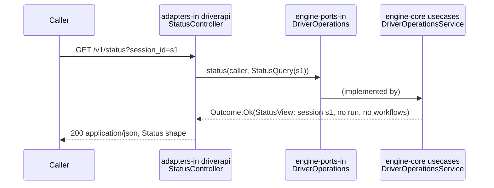

# 017 · Plan: Engine skeleton

## Approach

Build the engine's Maven reactor under `engine/` with the six modules of `docs/engine/design.md` section 1, starting from spike 013's module-rules prototype (`specs/013-*/prototype/module-rules/`), which already proved the build rules. The reactor carries its own Maven Wrapper, Maven settings (Maven Central), and JDK 25 selection, so a fresh clone builds the same everywhere.

Only one operation goes through the full hexagon: the stub `status`. It is the worked example the `engine-change` skill was waiting for: a port method in `engine-ports-in`, a use case in the core's `usecases` package, and an HTTP mapping in `adapters-in`'s `driverapi` package. `engine-app` adds the Spring Boot main, the Flyway migration that creates the `engine` schema, the health endpoint over the database, and the ArchUnit rules.

The module rules are proven by a planted-violation script carried over from the prototype, one plant per row of design section 1's "How the rules are checked", and run in CI so a weakened rule is caught. A new required CI job, `engine`, runs the build, the tests (one of them on PostgreSQL 18 in Testcontainers), the 80% line-coverage gate, the 70% mutation gate, and the plant script.

## Constitution check

| Article | How the plan complies |
| --- | --- |
| 1. The engine is the sole authority | The engine is the only component that touches its schema; Flyway runs inside the engine at start. No other component exists yet. |
| 3. The engine is neutral | The ArchUnit name rule (camel-case word parts `Git`, `Claude`, `Sdlc`, `Merge`, `PullRequest`, design Q15) runs from the first commit, with a plant proving it fails and a test proving `digit`-style names pass. The stub `status` uses only neutral contract words. |
| 4. Drivers stay subscription-compatible | No model is invoked; CI adds no credential. |
| 5. Fail closed | The health endpoint reports DOWN with HTTP 503 when the database is unreachable (AC-6). If the database is unreachable at start, Flyway fails and the engine does not start, rather than serving without its schema. Code added to any module without tests fails `every-module-tested.sh`, since JaCoCo and PIT both pass a module with no tests; no module skips either gate (Quality gates). |
| 7. Pinned and replayable | Schema changes are versioned Flyway migrations from V1, forward-only. |
| 8. Enforce gates off the laptop | Every gate (module rules, plants, coverage, mutation) runs in the required `engine` CI job, not only locally. |
| 9. Need no orchestrator | `status` is a pull operation; the engine pushes nothing. |
| 10. Happy path first | Only `status`, health, and an empty schema. No JPA, no entities, no auth, no outbound ports' implementations: each arrives with the Phase 1 spec that needs it. |
| 11. Tests prove acceptance criteria | Every AC maps to a test or a recorded check (Test strategy). |
| 12. Small, traceable increments | Twelve tasks, one commit each. |
| 13. Specs are living | The design's placeholder base package is settled in `docs/engine/design.md`; the `engine-change` skill's draft steps are corrected from the worked example. |
| 14. Decisions are written down | Decisions table below. |
| 15. Verify current docs | Versions below were checked on 2026-11-01 (Versions). |

Articles 2 and 6 are about human steps and evidence, which this spec does not touch.

## Design

### Versions

Checked 2026-11-01 against current documentation (Art. 15).

| Item | Version | Note |
| --- | --- | --- |
| JDK | 25 (Temurin in CI) | Selected by the toolchains plugin, not the shell's `java` |
| Maven / Wrapper | 3.10.0 / wrapper 3.3.4 (`only-script`) | Maven 4 is not GA; the ubuntu-24.04 image also ships 3.10.0 |
| Spring Boot (parent) | 4.1.2 | Spring Framework 7.0.10, Jackson 3.1.7, JUnit Jupiter 6.0.3, HikariCP 7.0.2, PostgreSQL JDBC 42.7.14 |
| Flyway | 12.4.0 (Boot-managed) | Boot 4 needs the `spring-boot-flyway` module, plus `flyway-database-postgresql` |
| PostgreSQL | 18 | `postgres:18` image locally and in Testcontainers |
| Testcontainers | 2.0.5 (Boot-managed) | 2.x modules are `testcontainers-*`; older versions break on Docker Engine 29 |
| ArchUnit | 1.5.1 | Java 25 class files since 1.4.1; declare `archunit` and `archunit-junit5-api`, with `archunit-junit5-engine` ignored as unused-declared (spike 013) |
| maven-dependency-plugin | 3.11.0 | `analyze-only`, `failOnWarning`, `ignoredUnusedDeclaredDependencies` in `engine-app` |
| maven-toolchains-plugin | 3.3.0 | `select-jdk-toolchain`, `version` 25, discovers installed JDKs with no `toolchains.xml` |
| JaCoCo | 0.8.16 | Java 25 official since 0.8.14; `check` gates one module at a time |
| PIT / pitest-junit5-plugin | 1.30.1 / 1.2.3 | Thresholds are per module; `failWhenNoMutations` defaults to true; JUnit 6 support not stated (Risks) |
| actions/setup-java | v6.1.0, `b843ebf9b913146b38da2eaa7aeddf76074ae1ad` | Temurin 25, `cache: maven`; the runner's default JDK is 17 |

### Layout

```text
engine/
  mvnw, mvnw.cmd, .mvn/            wrapper, maven.config (`-s` `.mvn/settings.xml`), settings.xml (Maven Central)
  pom.xml                          reactor parent: Boot parent, plugin config, quality gates
  compose.yaml                     local PostgreSQL 18 for running the engine natively
  engine-ports-in/                 aiworkflow.engine.port.in
  engine-ports-out/                aiworkflow.engine.port.out (empty until the DecisionEngine stub)
  engine-core/                     aiworkflow.engine.core.usecases
  adapters-in/                     aiworkflow.engine.adapter.in.driverapi
  adapters-out/                    aiworkflow.engine.adapter.out (empty until the DecisionEngine stub)
  engine-app/                      aiworkflow.engine.app: Boot main, application.yaml, db/migration/engine, ArchUnit tests
  architecture-plants/             one folder per planted violation, plus run.sh
```

Maven resolves the relative `-s` path in `maven.config` against the current directory (MNG-6762, unfixed in 3.x), so every command runs from `engine/`: the README, CI (`working-directory: engine`), and the plant script all do.

Base package `aiworkflow.engine` and groupId `aiworkflow`, settling the design's placeholder (D1). Modules with no code yet declare no engine dependency, since `analyze-only` would flag an unused one; each gets a `package-info.java` naming what goes there, so the package exists for the ArchUnit rules.

### The stub `status` through the hexagon



- **`engine-ports-in`:** `DriverOperations` with only `status(Caller, StatusQuery)` for now, returning `Outcome<StatusView>`; `Outcome`, `Denial`, `DenialCode`, `Caller`, `CredentialKind` as in design section 2, so Phase 1 adds methods without changing these. `StatusView` holds what an unbound session's answer needs: `contractVersion`, `session` (id, bound run ID), `startableWorkflows`, `pending`, `recommendations`, `next` (action, hint). The run-dependent parts (`run`, `stage`, `open_attempt`, `last_decision`, `permitted_transitions`, `protected_actions`) join the port with Engine core, where they first have values (D4).
- **`engine-core` `usecases`:** `DriverOperationsService implements DriverOperations`. `status` returns the fixed unbound answer: contract version `v1`, the session with no bound run, no startable workflows, empty pending lists and recommendations, `next.action = none` with a generic hint. No authentication yet (spec Q3); the `Caller` is accepted and unused, with a comment pointing at the Phase 1 Driver API item.
- **`adapters-in` `driverapi`:** `GET /v1/status?session_id=…` maps the query to `StatusQuery`, the result to a hand-written contract record tree with snake_case names as in `docs/driver-api/README.md`, and writes every top-level Status field: the run-dependent ones as `null` or `[]`. A missing `session_id` is an `invalid_inputs` denial, `422`, as the contract's table says for a malformed request. `Outcome.Denied` maps every one of the 15 `DenialCode` values to the contract's HTTP status with an exhaustive `switch` and no `default` (design section 8), as an RFC 9457 problem body, so a code `status` gains later cannot go out unmapped; a unit test covers each code. The adapter builds `Caller` from the `Authorization` header if present (D12).

### Database, migrations, health

- `engine-app` declares real modules, not starters (spike 013): `spring-boot-webmvc`, `spring-boot-tomcat`, `spring-boot-jdbc` (which holds the database health indicator), HikariCP, the PostgreSQL driver, `spring-boot-flyway` with `flyway-database-postgresql`, `spring-boot-actuator-autoconfigure`, and `spring-boot-health`; tests add `spring-boot-testcontainers`, `testcontainers-postgresql`, and `testcontainers-junit-jupiter`. Modules used only through auto-configuration are runtime scope or listed in `ignoredUnusedDeclaredDependencies`. No JPA yet (D3).
- Flyway: `schemas: engine`, locations `classpath:db/migration/engine`, so Flyway creates the schema and keeps its history table there. `V1__engine_schema.sql` holds one statement, `COMMENT ON SCHEMA engine IS …`, so the first migration is real and recorded; Engine core's `V2` brings `schema-draft.sql`.
- Connection settings come from environment variables with defaults matching `engine/compose.yaml` (`localhost:5432`, database `awf`, user `engine`). The password default is a local-only value in `compose.yaml`, never a real secret.
- Actuator exposes only `health` over HTTP at `/actuator/health`, with the `db` indicator. DOWN maps to `503` (Actuator's default status mapping, left unchanged). Only a database lost after start reaches this path; one missing at start stops the engine at Flyway. Details are shown (`show-details: always`) so AC-5 and AC-6 can see the `db` component; the endpoint is local-only until manifests and login exist.

### Module rules

`ArchitectureTest` in `engine-app` (test scope) ports the prototype's rules to the real packages, and adds what the design added after the prototype:

| Design row | Rule | Plant |
| --- | --- | --- |
| Inbound adapters depend only on inbound ports | Maven (only `engine-ports-in`); ArchUnit second line | `in-uses-core`: `driverapi` imports a core class (compile fails) |
| Adapters do not use each other | ArchUnit: no `adapter.in..`/`adapter.out..` package depends on another adapter package | `adapter-to-adapter`: a second `adapter.in` package uses `driverapi` |
| Core depends only on itself and the ports | Maven | `core-uses-adapter`: core imports `driverapi` (compile fails) |
| Each outbound adapter depends only on its port | Maven; ArchUnit per adapter package | `out-uses-other-port`: a planted outbound adapter uses another port's package |
| No transitive leaks | `analyze-only`, `failOnWarning`, every module | `transitive`: `driverapi` uses a `spring-core` class only reachable through `spring-webmvc` |
| No SDLC, git, or Claude Code names | ArchUnit, camel-case word parts over class, package, and member names in core and ports (D6) | `banned-name`: `core.usecases.GitRevision` and a member `authorizeMerge` |
| Broker product only in `brokerclient` | ArchUnit on `com.google.cloud.pubsub..` | `broker-in-core`: a planted stub class in `com.google.cloud.pubsub.v1` used from the core (no real Pub/Sub download) |
| No JPA types in port signatures | ArchUnit: ports do not depend on `jakarta.persistence..` or core | `jpa-in-port`: an `@Entity` in `port.in`, with a pom profile adding `jakarta.persistence-api` |
| Allowed calls between core packages, no cycles | ArchUnit `layeredArchitecture()` with the design's table (optional layers allowed, since most packages do not exist yet) and `slices().beFreeOfCycles()` | `core-call`: `core.runs` calls `core.checkpoints` |
| Pure rule code stays pure | ArchUnit: `core..rules..` does not depend on `jakarta.persistence..`, `org.springframework..`, or entities | `impure-rule`: a `core.scoring.rules` class uses a Spring type |

Besides the rows above, ArchUnit states every module edge of design section 1 as a rule over packages: ports depend on no other engine package; the core on no `adapter..` or `app..` package; `adapter.in..` only on `port.in..`; `adapter.out..` only on `port.out..`. With `analyze-only` (no unused declared dependency), this proves AC-1's "only the modules design section 1 allows": an edge used in code fails ArchUnit, and one declared but unused fails `analyze-only`. A plant `out-uses-core` covers the Maven half of the outbound adapter row (compile fails).

Rules whose subject packages do not exist yet are marked `allowEmptyShould(true)` one by one, not globally, so a typo in a package name in a rule that should have classes still fails.

`architecture-plants/run.sh` keeps the prototype's mechanics: copy one plant into the tree, run the build (online, so the plant profiles' extra dependencies such as `jakarta.persistence-api` resolve on a fresh CI cache) with `-Dplant=<id>` (which turns on a matching pom profile where a plant needs a dependency) and with the slow gates off, remove the files, and check the log. Each plant folder has an `expect` file: a pattern for the tool that must catch it (`COMPILATION ERROR`, `Used undeclared`, or the ArchUnit rule name). The script fails if a plant builds green or fails at another tool, and ends with a clean build that must pass. A trap removes planted files on any exit.

### Quality gates

- **Coverage (R9):** JaCoCo `prepare-agent` and a `check` (BUNDLE, LINE, COVEREDRATIO, minimum 0.80) in every module with code, from the parent's `pluginManagement` (D7). `check` reads only the module's own tests, so each module with code has its own tests, including `engine-ports-in`. `EngineApplication` is excluded; nothing else is. JaCoCo passes a module with no execution data, and PIT skips a module with no tests, so `engine/scripts/every-module-tested.sh` runs after the build and fails if any module has production classes but no test results (T2 deviation).
- **Mutation (R10):** PIT with the JUnit 5 plugin, `mutationThreshold` 70, in every module, in a `mutation` profile. No module sets `skip`. `failWhenNoMutations` is false everywhere: zero mutations means no mutable code (`engine-ports-in` may hold only records, enums, and interfaces, whose generated methods PIT filters; `engine-ports-out` and `adapters-out` are empty), while code added without tests is caught by `every-module-tested.sh` (D11, T2 deviation). `EngineApplication` is excluded with `excludedClasses`. Integration tests are named `*IntegrationTest`, run by Surefire, and excluded from PIT with `excludedTestClasses`, so PIT runs only unit and MockMvc tests (D8, D10).
- **CI (R11):** a new job `engine` in `.github/workflows/ci.yml`, following the file's conventions (checkout with `persist-credentials: false`, actions pinned by SHA, no path filters): `actions/setup-java` with Temurin 25 and the Maven cache, then `./mvnw -B -Pmutation verify` in `engine/`, then `scripts/every-module-tested.sh`, then `architecture-plants/run.sh` with `if: ${{ !cancelled() }}` so both results show. The pull request says CI gets stricter: a new required check that needs Docker and JDK 25. `engine` is added to `.github/rulesets/main.json`; after merge the owner runs `.github/scripts/apply-ruleset.sh --verify` (CONTRIBUTING "Adding a CI check").

### Documents

- `CLAUDE.md`: "Current state" says the engine skeleton exists; a new "Commands" section with build, test, run (R12).
- `engine/README.md`: the same commands, the module table, and how to run the plants.
- `PLAN.md`: the Engine skeleton item says "stub `status` on the HTTP driver API"; a new item "MCP gateway skeleton" right after it (R13). Ticked at verify.
- `docs/engine/design.md` section 1: the base package is `aiworkflow.engine`, no longer a placeholder.
- `.claude/skills/engine-change/SKILL.md`: drop "Draft"; add the `status` files as the worked example; fix any step the code proved wrong.

## Requirement coverage

| Requirement | Covered by |
| --- | --- |
| R1 | Six-module reactor (T1) |
| R2 | `analyze-only` (T2), `ArchitectureTest` (T7), proven by the plants (T8) |
| R3 | Wrapper, `.mvn/maven.config`, `.mvn/settings.xml`, toolchains plugin (T1); manual check (T11) |
| R4 | Flyway config and `V1__engine_schema.sql` (T6) |
| R5 | Actuator health with the `db` indicator (T6) |
| R6 | Actuator DOWN → 503 (T6) |
| R7 | Stub `status` through port (T3), use case (T4), adapter (T5), app (T6) |
| R8 | Testcontainers PostgreSQL 18 tests in `engine-app` (T6) |
| R9 | JaCoCo `check` at 0.80 per module (T2), met by each module's tests (T3–T6) |
| R10 | PIT `mutationThreshold` 70 (T2), met by each module's tests (T3–T6) |
| R11 | `engine` CI job and ruleset entry (T9), the landing pull request (T12) |
| R12 | `CLAUDE.md`, `engine/README.md` (T10); manual check (T11) |
| R13 | `PLAN.md` edits (T10) |

## Decisions

| # | Decision | Alternatives | Why |
| --- | --- | --- | --- |
| D1 | Base package `aiworkflow.engine`, groupId `aiworkflow` | A reverse domain name | The project owns no domain; the design already uses this name throughout, so nothing else changes |
| D2 | JDK 25 chosen by the toolchains plugin's `select-jdk-toolchain` discovery; Maven itself may run on any JDK it supports | Enforcer `requireJavaVersion` (checks the JVM running Maven, so it fails instead of selecting); `.sdkmanrc` or `.java-version` (needs a tool) | AC-3: a machine whose default is another JDK still builds with 25, with no manual step, as long as a JDK 25 is installed |
| D3 | No JPA or Hibernate yet: plain JDBC for health, Flyway for the schema | Add Spring Data JPA now with `ddl-auto=validate` and no entities | Article 10; JPA arrives with the first entity in Engine core, where its config can be tested against real tables |
| D4 | `StatusView` carries only the unbound parts now; the adapter writes run-dependent fields as `null`/`[]` | Model the whole Status tree in the port now | The run types have no values or rules until Engine core; modelling them now is guesswork the Phase 1 spec would redo |
| D5 | Local database through `engine/compose.yaml` | Boot's Testcontainers dev-time run (`spring-boot:test-run`); wait for the manifests item | Explicit, survives restarts, and matches the in-cluster PostgreSQL the dev loop will later point at |
| D6 | Name rule matches camel-case word parts, not substrings | The prototype's substring regex | Design Q15: substrings flag `digit` or `emerge`; a test proves those names pass |
| D7 | 80% line coverage per module with code, by JaCoCo's `check` | One gate over `report-aggregate` (no documented goal; needs merge tricks or a script over the XML) | The documented mechanism; a small test per module is cheap, and PIT already backs up a module with no tests |
| D8 | Mutation gate per module, unit and MockMvc tests only | Mutate under the Testcontainers tests too | Spring contexts and containers make PIT slow and flaky; the logic under mutation is in core and adapters, which have fast tests |
| D10 | Integration tests run under Surefire, named `*IntegrationTest` | Failsafe with `*IT` | One plugin and one `verify` command; the name pattern is enough for PIT to exclude them |
| D11 | `failWhenNoMutations` false in every module; no `skip`; a guard script for modules with code but no tests | `skip` in modules without logic; Surefire `failIfNoTests` with overrides in empty modules | `skip` would let untested code added later pass both gates silently; the guard needs no per-module override that a later spec could forget to remove |
| D12 | `Caller` is built from an optional `Authorization` header, though unused | Leave `Caller` out of the port until Phase 1 | The port signature matches design section 2 now, so the Driver API item adds authentication without changing it |
| D13 | Actuator `show-details: always`; wrapper `only-script` | Details hidden; wrapper with a JAR | Details let tests and people see the `db` component while the engine is local-only (revisit with manifests and login); `only-script` keeps binaries out of git and is the wrapper's default |
| D9 | Plants run in CI on every pull request | A local script used once at verify | Keeps a weakened or deleted rule from passing silently (Art. 8); the build is small, so the cost is a few minutes |

## Test strategy

| Acceptance criterion | Verified by |
| --- | --- |
| AC-1 | CI `engine` job runs `./mvnw -B verify` on a fresh checkout; the module-edge ArchUnit rules plus `analyze-only` prove each module depends only on what design section 1 allows (T7) |
| AC-2 | `architecture-plants/run.sh` (T8): every plant fails at its expected tool; the clean build passes |
| AC-3 | Manual check (T11): with `JAVA_HOME` on another JDK and a `~/.m2/settings.xml` mirror pointing at an unreachable host, `./mvnw -B -Pmutation verify` and the run command both succeed, and the log shows the JDK 25 toolchain. CI runs on Temurin 25 only, so it does not prove this |
| AC-4 | Integration test (Testcontainers, `@ServiceConnection`, which also points Flyway at the container): start the app on an empty database, query `engine.flyway_schema_history` for V1 success; restart the context, nothing new applied |
| AC-5 | Integration test: `GET /actuator/health` returns 200, `UP`, `components.db.status = UP` |
| AC-6 | Integration test with its own container: stop the container, `GET /actuator/health` returns 503 and `DOWN` |
| AC-7 | MockMvc test of `driverapi` with a fake port; core unit test of the use case; integration test over real HTTP; field names checked against the Status shape in `docs/driver-api/README.md` |
| AC-8 | The AC-4 to AC-7 integration tests run on `postgres:18` |
| AC-9 | JaCoCo check in the build; manual check at verify: a scratch branch adding an untested class drops coverage below 80% and the job fails |
| AC-10 | PIT threshold in the build; manual check at verify: a scratch branch weakening a test drops the score below 70% and the job fails |
| AC-11 | The landing pull request's checks; `apply-ruleset.sh --verify` after merge shows `engine` required |
| AC-12 | Manual check (T11): follow `engine/README.md` on a fresh clone, `curl` health and status |
| AC-13 | `grep` in the task check |

## Risks and unknowns

- **PIT and JUnit 6.** Boot 4.1 manages JUnit Jupiter 6.0.x; pitest-junit5-plugin 1.2.3 states no JUnit 6 support, though a third-party guide runs them together. T1 smoke-tests PIT on one module first; if it fails, a Deviation records the fix (a pinned JUnit Platform launcher, or a newer plugin).
- **Toolchain outside the compiler.** PIT forks test JVMs and `spring-boot:run` starts its own JVM; if either ignores the selected toolchain while Maven runs on an older JDK, it gets the wrong Java. The AC-3 manual check runs both; a failure is fixed in config (for example PIT's `jvm` parameter) and recorded under Deviations.
- **Settings path.** Running Maven from a submodule folder breaks the relative settings path (MNG-6762). Documented: run from `engine/`.
- **PIT on records and tiny modules.** Few mutable lines means one surviving mutant moves the score a lot. Tests on the use case and the adapter mapping must kill every mutant they can; equivalent mutants are excluded by name, with a reason.
- **Docker on CI and locally.** Testcontainers needs Docker; GitHub's ubuntu runners have it, and the Mac has Docker Desktop.
- **The user's `~/.m2` mirror** (a stalled corporate Nexus, spike 013) is bypassed by the project settings; the wrapper download itself also goes to Maven Central via `.mvn/wrapper/maven-wrapper.properties`.
- **CI time.** Build, mutation, and ten plant builds; if the job passes about ten minutes, the plants move to running only ArchUnit and `analyze-only` per plant.

## Deviations

| Task | Change | Why |
| --- | --- | --- |
| T1 | The toolchain `version` is the range `[25,26)`, not `25` | `select-jdk-toolchain` matched `25` exactly against `25.0.3` and found no JDK; the range selects any JDK 25 (tested with Maven running on JDK 26) |
| T2 | Added `engine/scripts/every-module-tested.sh`, run after the build in T2's check and in CI (T9) | PIT prints "Project has either no tests or no production code" and skips, and JaCoCo skips without execution data, so a module with code and no tests passed both gates; D11 assumed PIT would score it 0%. Tested: an untested class in `engine-ports-out` fails the guard |
| T3 | `StatusView` leaves out `pending` and `recommendations`; the adapter writes them empty, like the other run-dependent fields. `CredentialKind` gained `NONE` for a caller with no credential. PIT 1.30.1 with pitest-junit5-plugin 1.2.3 runs on JUnit Jupiter 6.0.3 (the JUnit 6 risk did not happen) | With no run there is nothing pending and nothing recommended, and the contract gives `recommendations` no item shape yet (D4 applied to them too). The stub `status` takes calls with no credential (spec Q3) |
| T5 | `analyze-only` sets `ignoreNonCompile`: unused declarations are checked in compile scope only; used-undeclared stays checked in every scope. The JUnit and ArchUnit engine ignores are no longer needed | MockMvc tests need Hamcrest, the Servlet API, JsonPath, and Jackson on the test classpath with no bytecode reference, and engine-app needs auto-configuration modules at run time; listing each as ignored would grow with every test library. The design's rule, no transitive leaks, is the used-undeclared check, which is unchanged |
| T6 | `engine-app` also declares `snakeyaml`, `spring-boot-jackson` (run time) and `spring-context`; `spring-beans` and `spring-jdbc`, used by tests, are declared at run time scope, not test | Starters normally bring SnakeYAML (without it `application.yaml` does not load) and Jackson. A direct test-scope declaration would win over the transitive run time one and drop the jar from the packaged app; checked with `unzip -l` on the repackaged jar |
| T8 | Plant logs go to `engine/architecture-plants/logs/` (git-ignored); plant builds skip the integration tests with `-Dtest=!*IntegrationTest` as well as JaCoCo and PIT | `clean` deletes `engine/target`, so logs there vanished; no plant needs the database, and the run takes about 40 seconds |
| T10 | `engine-app` declares `jackson-databind` at run time scope; new task T13 smoke-tests the packaged jar in CI; `spring-boot.run.skip` is true in the parent and false in `engine-app`, so `./mvnw -pl engine-app -am spring-boot:run` works | Declaring it at test scope (for the health tests) dropped it from the run time classpath: every test passed, but the engine did not start (`NoClassDefFoundError` in Flyway). Only a run of the packaged app catches that. Without the skip property, `spring-boot:run` also ran in the parent and library modules and failed |
